# Provenance

**Recording forensics: where and when.** Provenance looks for two kinds of clues that an audio or video file can carry without anyone noticing:

1. **Aircraft sound (Acoustic Locate).** A propeller plane passing overhead leaves a faint tone that slides down in pitch: the Doppler effect. The shape of that slide depends on the plane's speed and on how close it came. Provenance measures the slide and compares it with public flight tracks (ADS-B) to rank the places where a listener would have heard exactly that.
2. **Mains hum (ENF, electric network frequency).** Recordings made near power wiring often pick up a faint hum at 50 or 60 Hz. The grid's frequency drifts a little all the time, and the hum drifts with it. Matching that drift against grid frequency logs can date a recording, and racing several grids against each other can show which grid it came from.

It is built as a **privacy check**: use it on your own recordings to see what they give away before you publish them. Everything runs on your computer. Your audio is never uploaded.

## Origin and acknowledgements

Provenance began with two videos by the YouTube creator **colsto**: "I discovered a sound that leaks your exact location (and it's everywhere)", published November 2, 2026 [1], and its companion clip "Unknown location - raw audio", published October 31, 2026, Pacific time [2]. The first video showed that the Doppler slide of an aircraft's tone, matched against public flight tracks, can pin down where a recording was made. That idea is the basis of Acoustic Locate. The raw-audio clip was used only as a test input during development. It is not included in this repository.

Provenance is an independent reimplementation. The creator released no code or tools, and none was copied: every line here was written from scratch for this project, from the idea as described in the video and from the published research listed in [References](#references). The mains-hum (ENF) features, the grid race, the seismic reference and the video flicker analysis draw on the research literature rather than on the video.

> Status: research prototype, version 0.2.0. The validation below is honest about what is simulated and what is real. Read [Limitations](#limitations) before trusting any answer.

---

## Contents

- [Origin and acknowledgements](#origin-and-acknowledgements)
- [Features](#features)
- [Quick start](#quick-start)
- [Usage: the GUI](#usage-the-gui)
- [Usage: the command line](#usage-the-command-line)
- [Architecture and module map](#architecture-and-module-map)
- [Process flow diagrams](#process-flow-diagrams)
- [Methods and math](#methods-and-math)
- [Validation results](#validation-results)
- [Configuration and environment variables](#configuration-and-environment-variables)
- [Data formats](#data-formats)
- [Testing](#testing)
- [Development workflow](#development-workflow)
- [Roadmap](#roadmap)
- [Limitations](#limitations)
- [Responsible use](#responsible-use)
- [Data sources and licences](#data-sources-and-licences)
- [References](#references)
- [Licence](#licence)

---

## Features

**Acoustic Locate**
- Spectrogram with steady-tone suppression, ridge tracing and automatic flyover detection.
- Per-flyover fit of speed, closest slant distance, time of closest approach and base pitch, with ranges.
- Location search over a box: candidate grid, closest-approach tables per flight, timing and silence filters, then locked Doppler scoring of every candidate, refined in three passes (200 m, 100 m, 25 m).
- Two modes: two flyovers with an unknown time, or one flyover with a known clock time.
- ADS-B from a CSV, a dump1090/readsb SBS log, or the free adsb.lol day archive.
- Terrain from free AWS Terrain Tiles (`--dem auto`), a GeoTIFF, an `.npz` grid, or flat ground.
- Markdown report, JSON, map PNG and zip exports.

**Acoustic Locate · Leak Check**
- Says whether a recording carries flyover curves and what each one gives away.
- Tests whether a high-pass filter actually removes them (often it does not).

**ENF · mains hum**
- Hum check (present, weak, absent) and 50 or 60 Hz family guess.
- Multi-harmonic ENF extraction (harmonics 1 to 7) from the raw audio track of any audio or video file.
- Dating against a reference log, with a false-match chance and a plain confidence label.
- Continuity check: 5-minute pieces matched on their own to spot stalls and edits.
- **Grid race**: matches the hum against every grid with a free log for the time window (GB, Continental Europe, Nordic, US West, US East, US Texas, Quebec) and answers *decisive*, *likely* or *abstain*.
- Statistical fallback when no time is known: a calibrated classifier that abstains unless it is confident.
- **US West reference rebuilt from public seismometers** (`enf-rebuild`), plus a live collector (`enf-collect`), for dates no free grid log covers.
- **Video light flicker** (new in 0.2.0): lamps flicker at twice the mains frequency. For video files the picture is analysed beside the sound: rolling-shutter bands (read-out time entered or searched) or the aliased frame brightness for global shutters, static-scene and keyframe checks, its own grid race and time match, and an audio-versus-picture agreement check with a splice hint. It abstains when there is no flicker.
- A privacy verdict with suggested fixes.

**General**
- Local web GUI (FastAPI, single page, Leaflet bundled) bound to 127.0.0.1 only, with a built-in Help tab.
- Pure-Python core: numpy, scipy, matplotlib. No compiled extensions of its own.

---

## Quick start

You need **Python 3.10 or newer**. **ffmpeg** is needed for anything that isn't a WAV file (video files, m4a, mp3 and so on).

```bash
git clone <your-fork-url> provenance      # or unzip the release archive
cd provenance
python3 -m venv .venv
. .venv/bin/activate
pip install -e ".[dev]"                   # core + GUI + tests
```

Optional extras:

| Extra | Installs | Needed for |
|---|---|---|
| `gui` | fastapi, uvicorn, python-multipart | `provenance gui` |
| `seismic` | websockets | `provenance enf-collect` (live SeedLink) |
| `dev` | pytest, httpx and everything in `gui` and `seismic` | running the tests |
| `enf-nordic` | py7zr | unpacking Fingrid monthly 7z archives (Nordic grid) |
| `enf-train` | scikit-learn | rebuilding the ENF fallback classifier |
| `geotiff` | rasterio | reading GeoTIFF terrain files |

Try it in one minute with a fully simulated scene (no downloads needed):

```bash
provenance demo --out demo_run
```

Or open the GUI:

```bash
provenance gui            # opens http://127.0.0.1:8765/
```

`make help` lists the common developer tasks (see [Development workflow](#development-workflow)).

---

## Usage: the GUI

```bash
provenance gui                       # opens your browser at http://127.0.0.1:8765/
provenance gui --port 9000 --no-browser
```

The server binds to 127.0.0.1 only and refuses any other address. Only public data is fetched from the internet: map tiles, and, when you choose them, flight history, grid logs and terrain tiles. Stop it with Ctrl+C.

The **Help** tab inside the app walks through every step in plain language. In short:

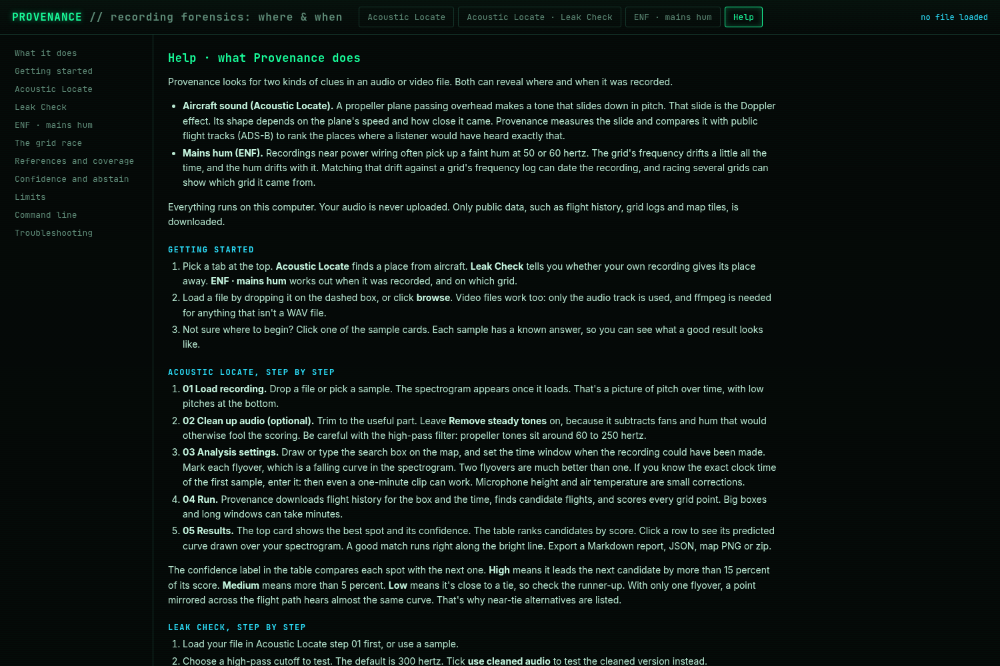

### Acoustic Locate

1. **Load recording.** Drop a file, or click a sample card. The simulated demo sample is built on first use; other sample cards need their datasets (see [DATA_SOURCES.md](DATA_SOURCES.md)) and show as unavailable without them.
2. **Clean up audio (optional).** Trim, high-pass, low-pass, remove steady tones, noise reduction, gain. Before and after spectrograms update as you move sliders.
3. **Analysis settings.** Known or unknown recording time, search box on the map, ADS-B source, terrain, grid spacing, optional flyover windows, microphone height and air temperature.
4. **Run.** Progress bar and live log. Large boxes and long windows can take minutes.
5. **Results.** Best estimate, confidence, ranked candidate table (click a row to see its tracks and predicted curves), zoomable spectrogram with overlays, heat map, exports.

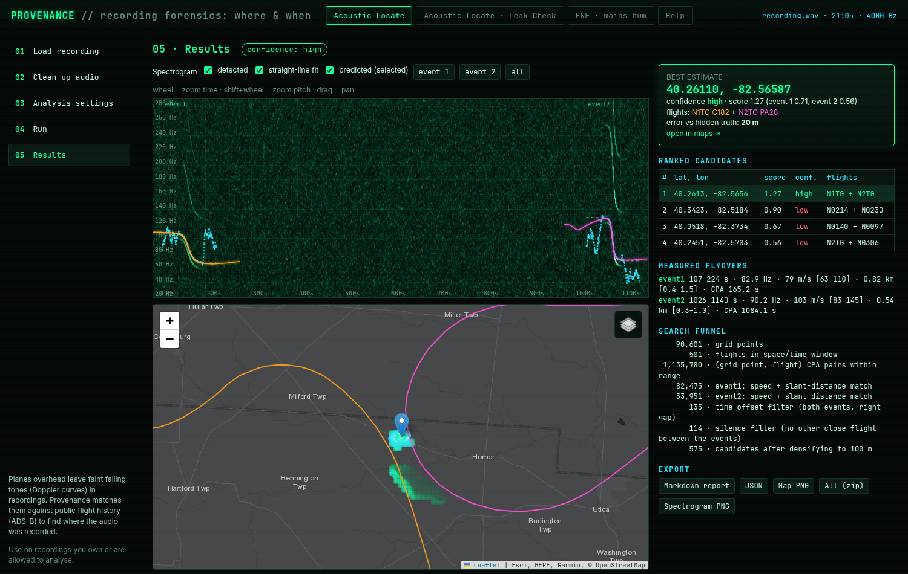

### Acoustic Locate · Leak Check

Load a file in Acoustic Locate first. Pick a high-pass cutoff to test (default 300 Hz), then run. It lists each flyover curve found, what it reveals, and whether the filter removed it.

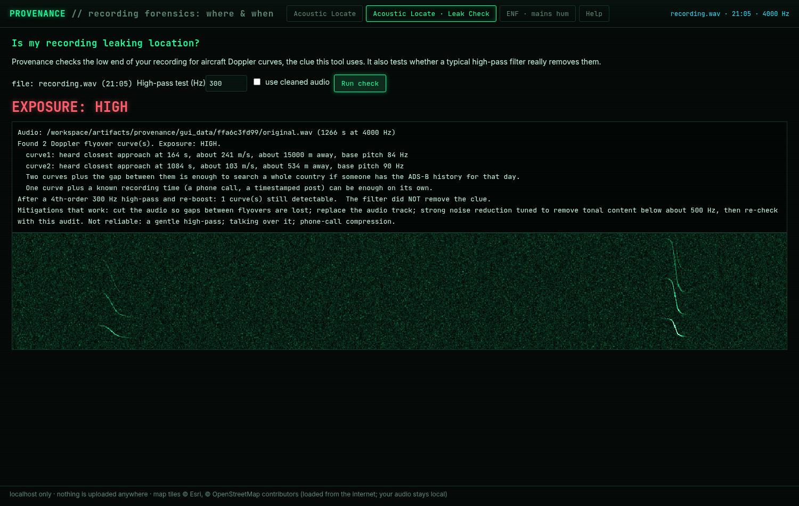

### ENF · mains hum

Drop an audio or video file (only the raw audio track is used; this tab never uses the cleaned audio, because clean-up removes hum). Pick a reference (built-in grid log, your own CSV/WAV/NPZ, or none), optionally a time window, and run. Results: hum check, ENF trace, best-fit time with false-match chance and label, continuity check, grid race table and chart, privacy verdict.

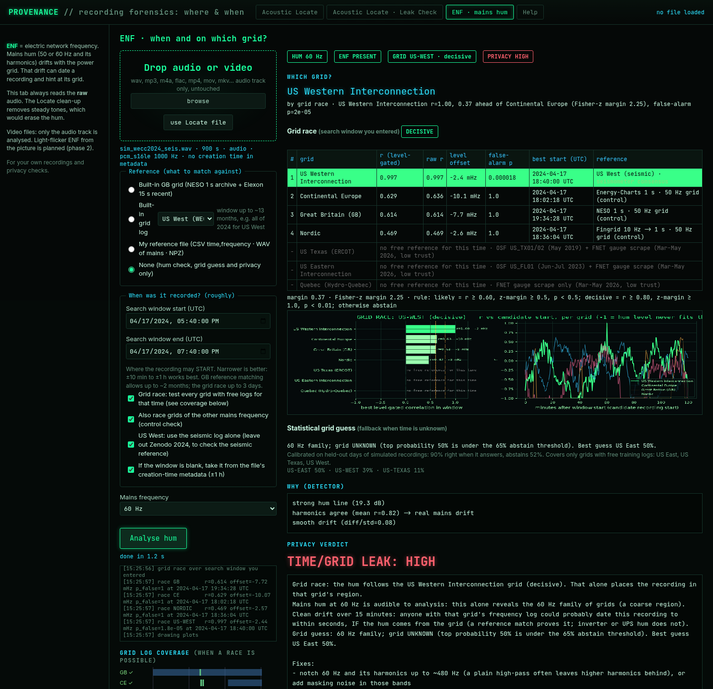

For video files the tab also reads the picture. The **Video: light flicker** box sets the picture analysis (auto, on, off) and the rolling-shutter read-out time in milliseconds (blank means search it). Results add a picture panel: status, path, read-out time, keyframe interval, the picture trace beside the hum trace, the agreement verdict, and the picture's own grid race. Samples (all simulated): agreement, a splice, a silent video and an anti-banding abstain.

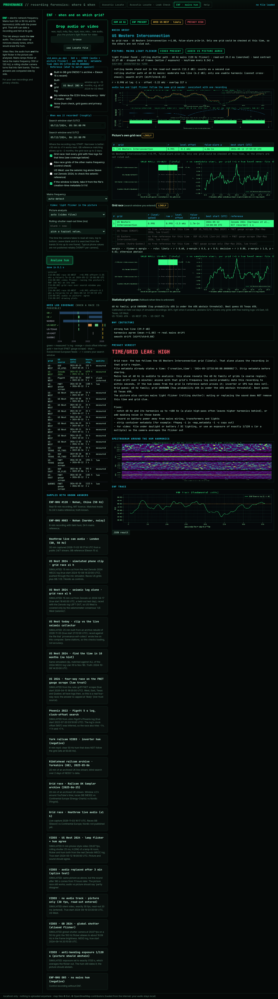
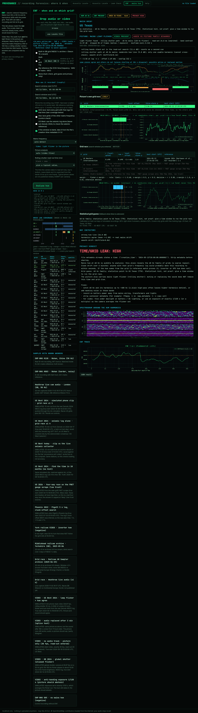
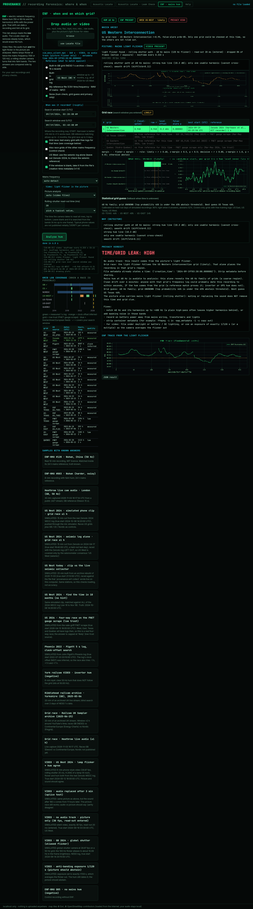
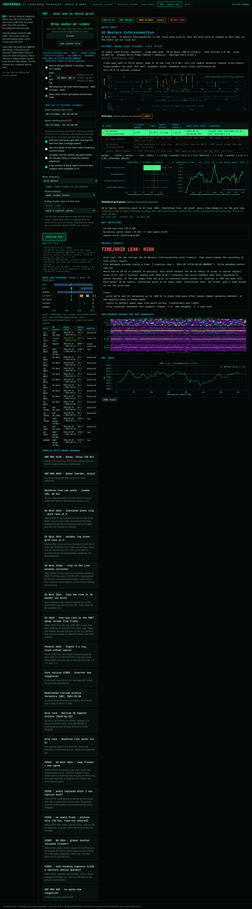

To regenerate screenshots, start the GUI and run `python scripts/gui_drive.py demo --clean` (needs Playwright with Chromium; not a dependency of the package).

---

## Usage: the command line

Every subcommand prints `--help`.

| Command | What it does |
|---|---|
| `provenance demo [--out DIR] [--seed N]` | Simulate a scene, then run both locate modes against the hidden truth and write reports. |
| `provenance simulate [--out DIR] [--seed N]` | Only build a simulated scene (audio, ADS-B CSV, terrain, truth JSON). |
| `provenance measure AUDIO [--events A-B,C-D] [--fmin HZ] [--fmax HZ] [--out DIR]` | Detect and fit flyovers; write `measurements.json`. |
| `provenance locate --audio F --adsb F --bbox LAT0,LAT1,LON0,LON1 --start T --end T [...]` | Full location search; writes a report. |
| `provenance audit AUDIO [--test-highpass HZ]` | Leak check: flyover curves and whether a high-pass removes them. |
| `provenance gui [--port N] [--no-browser]` | Start the local GUI. |
| `provenance enf MEDIA [--ref gb\|none\|FILE] [--start T --end T] [--nominal 50\|60] [--no-race] [--no-meta-time] [--out DIR]` | ENF analysis and grid race. |
| `provenance enf-rebuild [--grid US-WEST\|US-TEXAS\|US-EAST] --start DAY [--end DAY] [--yesterday] [--fill-only] [--stations LIST] [--out-dir DIR]` | Rebuild past days of grid frequency from public seismometer archives. |
| `provenance enf-collect [--minutes N] [--out-dir DIR] [--sdr-config JSON] [-v]` | Live seismic collector over one SeedLink (wss, port 443) connection. |

### Examples

```bash
# 1. Measure flyovers (auto-detect, or set windows in seconds)
provenance measure my_clip.wav --out work
provenance measure my_clip.wav --events 95-230,1010-1160 --fmin 30 --fmax 250 --out work

# 2. Turn a day of the free adsb.lol archive into a CSV for your area
cat v2026.09.08-planes-readsb-prod-0.tar.* | \
  python -m provenance_fx.readsb_hist --bbox 40.3,41.4,-74.5,-72.8 --out adsb_box.csv

# 3. Locate, time unknown (two flyovers)
provenance locate --audio my_clip.wav --adsb adsb_box.csv --dem auto \
  --bbox 40.60,41.10,-73.90,-73.20 --start 2026-09-08T00:00Z --end 2026-09-09T00:00Z \
  --height 4 --temp-c 22 --max-gap 300 --out work/locate

# 3b. Locate, start time known (one flyover can be enough)
provenance locate ... --clip-start 2026-09-08T20:36:40Z --max-events 1

# 4. Leak check
provenance audit my_clip.wav --test-highpass 300

# 5. ENF: grid race over a 4-hour window, plots and JSON in enf_out/
provenance enf clip.m4a --ref none --start 2025-06-25T17:00Z --end 2025-06-25T21:00Z --out enf_out

# 6. ENF: date against the built-in GB log (NESO 1 s + Elexon 15 s)
provenance enf clip.wav --ref gb --out enf_out

# 7. Rebuild US West grid frequency for a past day from seismometers
provenance enf-rebuild --grid US-WEST --start 2024-04-17

# 8. Run the live collector for 30 minutes, then fill holes from the archive
provenance enf-collect --minutes 30
provenance enf-rebuild --yesterday --fill-only

# 9. Video: sound and picture light flicker, read-out time known, race over a 20-minute window
provenance enf clip.mp4 --video on --readout-ms 25 --ref none --start 2024-05-12T17:50Z --end 2024-05-12T18:10Z --out enf_out
```

`python -m provenance_fx` is the same as `provenance`.

---

## Architecture and module map

```
provenance_fx/
├── cli.py            command line (all subcommands)
├── geo.py            local ENU frame, DEM helpers
├── dem_fetch.py      free AWS Terrain Tiles (Terrarium) fetch and decode
├── adsb.py           ADS-B loading (CSV, SBS), cleaning, smooth interpolation
├── readsb_hist.py    adsb.lol / readsb globe_history day archive -> CSV
├── physics.py        Doppler model: emission time, received pitch, straight-line closed form
├── spectro.py        STFT, steady-tone floor, normalisation, ridge tracing, event detection
├── measure.py        per-flyover least-squares fit (speed, slant distance, CPA time, base pitch)
├── search.py         candidate grid -> CPA tables -> filters -> locked Doppler scoring
├── report.py         figures and Markdown report
├── audit.py          Leak Check (flyover curves, high-pass test)
├── cleanup.py        audio clean-up used by the GUI
├── simulate.py       physically consistent synthetic scene
├── gui/
│   ├── server.py     FastAPI backend (127.0.0.1 only)
│   ├── enf_api.py    ENF tab endpoints (raw audio only)
│   ├── render.py, results.py
│   └── static/       single-page front end (index.html, app.js, style.css, vendored Leaflet)
└── enf/
    ├── media.py      raw audio track of any audio or video file (ffmpeg)
    ├── extract.py    hum scan, 50/60 Hz guess, multi-harmonic ENF extraction, hum detector
    ├── match.py      masked NCC, level gate, drift search, significance, labels, continuity
    ├── reference.py  GB reference (NESO 1 s archive, Elexon 15 s), CSV/WAV/NPZ references
    ├── grids.py      multi-grid reference layer (Energy-Charts, Fingrid, OSF weeks, ...)
    ├── us_refs.py    US references (Zenodo, Pigott, nate-griff scrape, home logger, seismic)
    ├── race.py       grid race and decision rules
    ├── gridid.py     statistical fallback classifier (time unknown)
    ├── grid_profiles.json   fallback model coefficients (plain JSON)
    ├── seismic.py    seismic hum tracking, agreement gate, consensus, archive rebuilder
    ├── seismic_live.py   live SeedLink collector
    ├── seismic_sdr.py    optional OpenWebRX cross-check
    ├── mseed.py      minimal miniSEED 2 reader (numpy only)
    ├── pipeline.py   one-call ENF analysis for the CLI and GUI
    ├── audit.py      ENF privacy verdict
    ├── video.py      light-flicker ENF from the picture: decode, quality, read-out search, tracking, A/V agreement
    ├── video_sim.py  synthetic lamp-lit videos (rolling / global shutter, H.264) for tests and validation
    ├── plots.py      PNG plots
    └── simulate.py   synthetic ENF clips and the microphone-chain model
```

Other folders:

| Path | What |
|---|---|
| `tests/` | pytest suite (74 tests). `tests/data/` holds a 40 KB miniSEED sample and its reference decode. |
| `scripts/` | Validation, model-building and GUI-driving scripts. Most need the datasets in [DATA_SOURCES.md](DATA_SOURCES.md). |
| `home_logger/` | Optional home grid-frequency logger (Raspberry Pi + Pico + GPS) and an importer. Guide: `docs/home_logger_guide.md`. |
| `docs/` | Design notes, research notes, validation write-ups, the seismic guide, screenshots and validation summaries (`docs/validation_runs/*.json`). |
| `examples/` | Small configuration examples (`flat_5m.json`: flat-ground terrain file). |

---

## Process flow diagrams

### Acoustic Locate

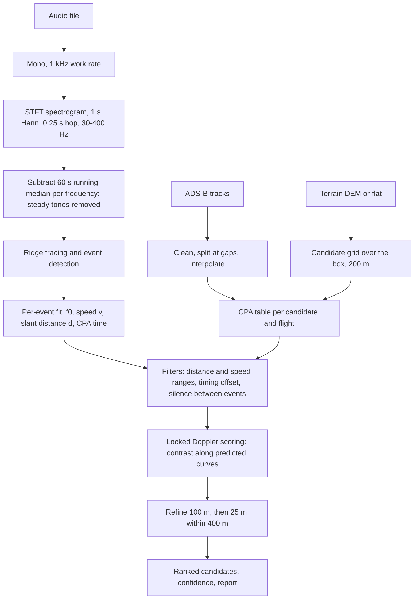

### Leak Check

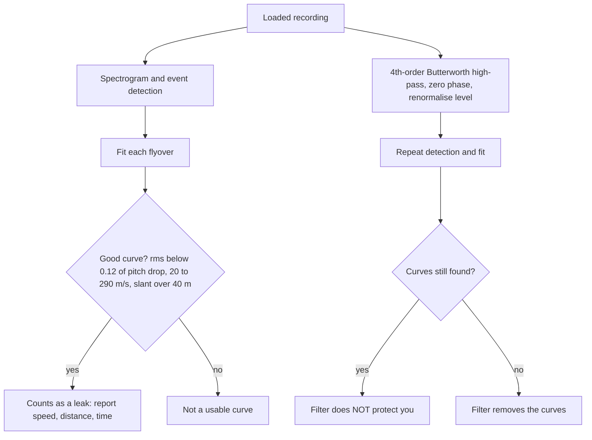

### ENF extraction and dating

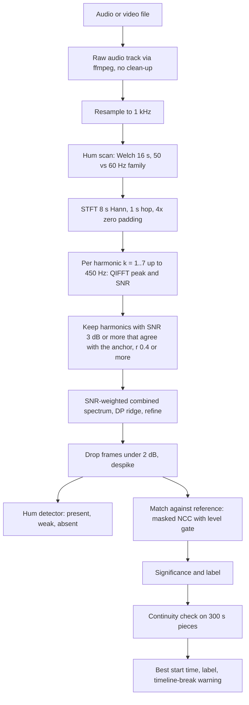

### Grid race

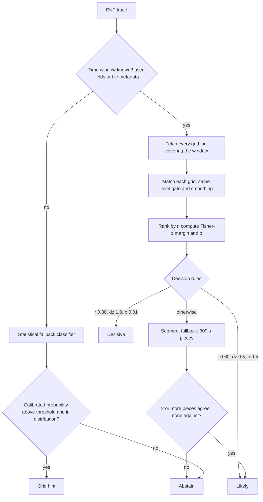

### Video light flicker

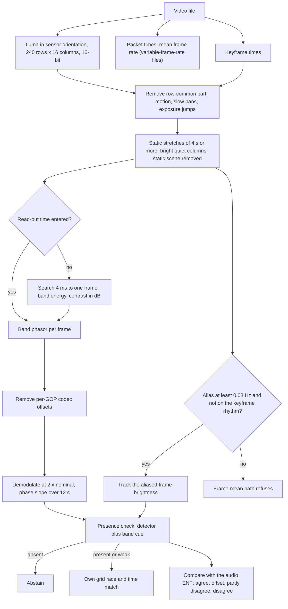

### Seismic reference: archive rebuild and live collector

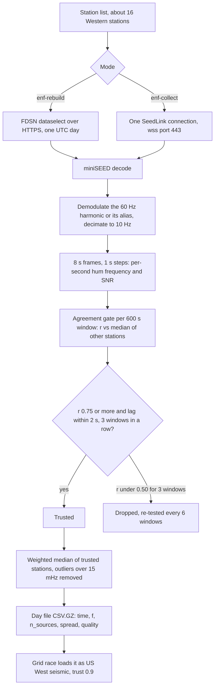

---

## Methods and math

All constants below are the values in the code at version 0.2.0. File names point to where each rule lives.

### 1. Doppler and aircraft geometry (`physics.py`)

The idea of locating a recording from an aircraft's Doppler slide comes from colsto [1]. Estimating an aircraft's speed and closest distance from the Doppler curve of its tone is established in the acoustics literature [62, 64, 63].

The speed of sound depends on air temperature $T$ in °C:

$$
c(T) = 331.3\,\sqrt{1 + \frac{T}{273.15}} \quad \text{(default } c = 343\ \text{m/s)}
$$

A source with true pitch $f_0$ at position $\mathbf{p}(t)$, heard by a fixed listener at $\mathbf{o}$, is received at

$$
f(t_{rx}) = f_0\,\frac{c}{c + v_r(t_e)}, \qquad v_r = \dot{\mathbf{p}}(t_e)\cdot\frac{\mathbf{p}(t_e)-\mathbf{o}}{\lVert\mathbf{p}(t_e)-\mathbf{o}\rVert}
$$

where the emission time $t_e$ solves

$$
t_{rx} = t_e + \frac{\lVert\mathbf{p}(t_e)-\mathbf{o}\rVert}{c}.
$$

This is solved by fixed-point iteration (8 iterations). The emission-time model matters: a naive model that ignores travel time gives a different curve, not just a delayed one (there is a test for this).

For a straight, level pass at speed $v$ with closest slant distance $d$, and $T$ the received time measured from the moment the closest-approach sound would arrive, the code uses the closed form

$$
a = c^2 - v^2,\qquad u = \frac{c^2 T - \sqrt{v^2 c^2 T^2 + a\,d^2}}{a},\qquad v_r = \frac{v^2 u}{\sqrt{v^2 u^2 + d^2}}.
$$

### 2. Measuring one flyover (`spectro.py`, `measure.py`)

- Spectrogram: STFT with a 1 s Hann window, 0.25 s hop, 1 kHz work rate, 30 to 400 Hz.
- Steady-tone floor: a running median over 60 s per frequency is subtracted, then the result is scaled by a robust spread (median absolute deviation × 1.4826). Fans, hum and HVAC lines drop out; sliding tones stay.
- The traced ridge is fitted with `scipy.optimize.least_squares` [95] (soft-L1 loss), started from slant distances 150 to 6000 m.
- Bounds: $f_0$ 10 to 2000 Hz, $v$ 5 to 300 m/s, $d$ 30 to 15000 m.
- Ranges handed to the search (σ is the fit's standard error):

$$
\Delta v_{lo} = \max(3\sigma_v,\ 0.2v,\ 10),\quad \Delta v_{hi} = \max(3\sigma_v,\ 0.4v,\ 15)
$$

$$
\Delta d_{lo} = \max(3\sigma_d,\ 0.45d),\quad \Delta d_{hi} = \max(3\sigma_d,\ 0.8d)
$$

### 3. ADS-B matching and location search (`search.py`)

Default `SearchParams`: grid 200 m, refine 100 m, fine 25 m within 400 m of the best points; maximum range 10 km; microphone 2 m above ground; timing tolerance 8 s; silence radius 2500 m with a 45 s margin, checked only *between* the two events; contrast offset 4 Hz; events normalised; time sweep ±5 s in 0.5 s steps; 9 base-pitch steps; known-time tolerance 30 s; clock tolerance 2 s.

1. **CPA tables.** For every candidate point and flight, the closest approach (time, slant distance, speed) is computed from the interpolated track. Tracks come from the adsb.lol archive [82]; ground height comes from the AWS terrain tiles [83].
2. **Filters.** A flight survives for an event if its closest-approach distance and speed fall in the fitted ranges. A pair survives if the predicted gap between the two heard closest approaches matches the measured gap within the timing tolerance, and no other aircraft came within the silence radius between the events.
3. **Locked Doppler scoring.** For each surviving pair, the predicted received-pitch curve $k\,f_m(t)$ (base-pitch scale $k$ swept) is laid over the cleaned spectrogram $B$. The score of one event is a *contrast*:

$$
S_e = \frac{1}{N}\sum_{t}\Big[B\big(t,\,k f_m(t)\big) - \tfrac12\Big(B\big(t,\,k f_m(t)+\Delta\big) + B\big(t,\,k f_m(t)-\Delta\big)\Big)\Big],\qquad \Delta = 4\ \text{Hz}
$$

   A curve that only passes through a broad loud patch scores near zero. Each event's score is divided by the score of the ridge actually traced in the audio (per-event normalisation), so a loud event cannot swamp a faint one:

$$
S = \frac{S_1}{S_1^{\text{ridge}}} + \frac{S_2}{S_2^{\text{ridge}}}
$$

4. **Confidence.** In the GUI, the relative gap between the best and next candidate decides the label: above 0.15 is high, above 0.05 medium, otherwise low. The CLI report uses the absolute score margin: above 0.5 high, above 0.15 medium.

With one flyover and a known clock time, a point mirrored across the flight path hears almost the same curve, so near-tie alternatives are listed.

### 4. Leak Check (`audit.py`)

A flyover counts as a leak if the fit is good (rms residual below 0.12 of the pitch drop), the speed is between 20 and 290 m/s, and the slant distance is over 40 m. The high-pass test applies a 4th-order Butterworth filter (zero-phase, `sosfiltfilt`), renormalises the level, and runs detection again.

### 5. Multi-harmonic ENF extraction (`enf/extract.py`)

ENF analysis as a forensic tool goes back to Grigoras [20, 21]. Combining several harmonics follows the spectrum-combining method of Hajj-Ahmad, Garg and Wu [22] and the harmonic-enhancement work of Hua et al. [34].

- Work rate 1 kHz; harmonics $k = 1 \dots 7$ with $k f_{nom} \le 450$ Hz.
- STFT frames: 8 s Hann, 1 s hop, 4× zero padding.
- For each harmonic, the peak bin $j$ in a band around $k f_{nom}$ is refined by **quadratic interpolation of the log spectrum (QIFFT)** [60]:

$$
\delta = \frac{1}{2}\,\frac{\alpha - \gamma}{\alpha - 2\beta + \gamma},\qquad \hat f_k = \frac{f_j + \delta\,\Delta f}{k}
$$

  where $\alpha, \beta, \gamma$ are log powers at bins $j-1, j, j+1$.
- SNR per harmonic is the peak over the median of a noise ring (more than 0.5 Hz beyond the band), minus the expected maximum of pure noise.
- Harmonics are kept if their median SNR is at least 3 dB and their smoothed track correlates with the anchor harmonic at $r \ge 0.4$. The anchor maximises $\text{SNR}_k + 10\log_{10}k$.
- Kept harmonics are combined on a common deviation grid (±0.3 Hz, 2 mHz steps) weighted by $10^{\text{SNR}_k/10}$. A dynamic-programming ridge tracks the peak with at most $\text{round}(0.03\cdot \text{hop}/0.002)$ grid steps per frame.
- Refinement: weighted mean of per-harmonic QIFFT estimates that sit within 20 mHz of the ridge,

$$
\hat f(t) = \frac{\sum_k w_k(t)\,\hat f_k(t)}{\sum_k w_k(t)},\qquad w_k = 10^{\text{SNR}_k(t)/10}\,k^2
$$

  Higher harmonics get $k^2$ weight because they give $k$ times finer resolution in fundamental units.
- Frames whose combined SNR is under 2 dB are dropped, then spikes are removed.

### 6. Hum detection (`enf/extract.py: hum_scan, detect_enf`)

Deciding whether a recording holds ENF at all is studied by Hua et al. [33]; the factors that weaken capture are surveyed in [26].

`hum_scan` uses a Welch spectrum (16 s segments), a band of $\pm(0.25k + 0.3)$ Hz around each harmonic and a noise ring 0.5 to 3 Hz away, to decide 50 or 60 Hz.

`detect_enf` adds up a score:

| Evidence | Points |
|---|---|
| Best harmonic SNR ≥ 10 dB / ≥ 5 dB | +0.35 / +0.2 |
| Harmonic agreement ≥ 0.7 / ≥ 0.4 / single harmonic | +0.3 / +0.15 / +0.1 |
| Too flat (std < 1.5 mHz, or cleanest harmonic < 2.0 mHz with ≥ 240 s and SNR ≥ 8) | −0.35 (crystal-locked inverter or UPS, not the grid) |
| Too wild (std > 60 mHz) | −0.2 |
| Plausible wander otherwise | +0.1 |
| Smoothness < 0.25 / < 0.5 | +0.2 / +0.1 |
| Valid fraction | + 0.05 × valid |

Verdict: **present** at 0.65 or more, **weak** at 0.4 or more, otherwise **absent**.

### 7. Matching: NCC, level gate, lag search and significance (`enf/match.py`)

Timestamping by correlating a recording's ENF against a grid log follows [17, 28, 35]; the significance test uses Fisher's z-transform [61].

- **Masked normalised cross-correlation** via FFT, so gaps (NaN frames) are ignored rather than zero-filled. For a lag $\ell$ over the valid samples:

$$
r(\ell) = \frac{\sum_t m_t\,(x_t - \bar x_\ell)(y_{t+\ell} - \bar y_\ell)}{\sqrt{\sum_t m_t (x_t-\bar x_\ell)^2}\,\sqrt{\sum_t m_t (y_{t+\ell}-\bar y_\ell)^2}}
$$

- **Level gate.** A recording's hum sits at the grid's actual frequency, so the mean offset between trace and reference must be small. With tolerance 0.010 Hz:

$$
r'(\ell) = r(\ell) - \frac{\max\big(0,\ |\Delta \bar f(\ell)| - 0.010\big)}{0.010}
$$

- **Sub-sample peak** by QIFFT on $r'$.
- **Clock drift search** when the clip is longer than 1800 s: ±100 ppm in steps of $\max(10, \text{ppm}/5)$.
- **Runner-up** is the best peak outside an exclusion zone of $\max(60\ \text{s},\ 0.5\cdot\text{duration})$.
- **Significance.** Effective sample size uses the integrated autocorrelation length $\tau$ (summed until the ACF drops below 0.05):

$$
n_{\text{eff}} = \frac{n}{\tau},\qquad z = \operatorname{atanh}(r)\,\sqrt{n_{\text{eff}} - 3},\qquad p_{\text{false}} = p_1(z)\cdot n_{\text{trials}}
$$

  where $n_{\text{trials}}$ is the number of lags searched.
- **Labels:**

| Label | r | gap to runner-up | p | duration |
|---|---|---|---|---|
| strong | ≥ 0.85 | ≥ 0.15 | < 1e-3 | ≥ 300 s |
| moderate | ≥ 0.7 | ≥ 0.08 | < 0.05 | |
| weak | ≥ 0.5 | ≥ 0.05 | | |

  Under 120 s is always "unreliable"; under 300 s is never "strong".

### 8. Continuity and timeline-break check (`enf/match.py: continuity, apply_continuity`)

Using ENF to find edits is described in [42, 10].

The trace is cut into 300 s pieces. Each piece with at least 60 % valid frames is matched on its own within ±600 s of the global fit. Shifts from pieces with NCC above 0.5 are compared; a jump larger than $\max(5\ \text{s},\ 1.5\times\text{reference resolution})$ counts as a break. Verdict: *continuous*, *possible gaps or edits*, or *not enough clean ENF to check*.

When a break is found and the first piece matches with NCC ≥ 0.8, `apply_continuity` keeps the global best fit but also reports `start_time_first_segment` and adds a "timeline break" warning: trust the start to tens of seconds, not to the second. This fixed a confident-wrong case where a simulated stall shifted the best overall fit by the missing seconds.

### 9. Grid race decision rules (`enf/race.py`)

Telling grids apart from ENF builds on [18, 24]. Reference logs: [65, 66, 67, 68, 69, 73].

Each grid with a log for the window is matched with the same gate and smoothing. With the best two grids at $r_1 \ge r_2$, the margin is in Fisher-z units (r clipped at ±0.995):

$$
\Delta z = \operatorname{atanh}(r_1) - \operatorname{atanh}(r_2)
$$

Fisher-z is used because 0.99 against 0.70 is much stronger evidence than 0.50 against 0.21.

| Answer | Rule (as coded) |
|---|---|
| **decisive** | $r_1 \ge 0.80$, $\Delta z \ge 1.0$, $p < 0.01$ |
| **likely** | $r_1 \ge 0.60$, $\Delta z \ge 0.5$, $p < 0.5$ |
| only one grid covered | needs $p < 0.05$, and is never better than likely |
| low-trust winner (trust < 0.8) | capped at likely, and needs $1.5\times$ the margin |
| clip shorter than 180 s | no race |
| otherwise | segment fallback, else **abstain** |

- **Segment fallback** (clips of at least 600 s, more than one grid): the race is re-run on 300 s pieces with at least 60 % valid frames. A piece votes for a grid if $r \ge 0.60$ and $\Delta z \ge 0.5$. The answer is *likely* only if at least 2 pieces agree on the grid at consistent times (a later piece may sit up to 30 s earlier, or up to $\max(120\ \text{s}, \text{duration})$ later) and no piece votes for another grid.
- **Uncertain source time zone** (for example the Pigott log): whole-hour shifts are tried and $p$ is multiplied by the number of shifts.
- **Cross-nominal control** (optional): 50 Hz logs are shifted onto 60 Hz (or back) and raced too. It is a sanity check, not a real competitor.
- **Time window** comes from the user, or from the file's `creation_time` metadata widened to $[t - \text{duration} - 1\,\text{h},\ t + 1\,\text{h}]$. The race is capped at 3 days.

### 10. Statistical fallback classifier (`enf/gridid.py`)

Classifying the grid without a matching time follows the location-classification work in [23, 54]; grid fluctuation statistics are described in [45].

When no time is known, a calibrated multinomial logistic model guesses the grid from ENF statistics: increment spread at 1 to 128 s, Haar wavelet variances, a fluctuation spectrum (5 bands plus slope), autocorrelation at 10, 30, 60 and 120 s, step kurtosis, jump and ramp fractions, and mean offset from nominal. It was trained on ENF extracted from real grid logs pushed through a simulated microphone chain. Probabilities are temperature-scaled:

$$
P(g) = \frac{\exp(s_g / \mathcal{T})}{\sum_h \exp(s_h / \mathcal{T})},\qquad \mathcal{T} = 1.137\ (50\ \text{Hz}),\ 1.083\ (60\ \text{Hz})
$$

It abstains when the top probability is under 0.69 (50 Hz) or 0.65 (60 Hz), when the clip is under 300 s, when less than 60 % of frames are valid, or when the trace is noisier than 98 % of training traces (out-of-distribution gate). The model is plain JSON (`grid_profiles.json`), so scikit-learn is only needed to rebuild it.

### 11. Seismic hum extraction and gating (`enf/seismic.py`, `enf/seismic_live.py`)

Data come from the FDSN networks PB, UW, UO, NN, MB, UI, TX and NX [84, 85, 86, 87, 88, 89, 90, 91] through EarthScope services [93], in miniSEED format [92].

Some seismometers sit close enough to power lines to record mains hum. The 60 Hz line (or its harmonic $k$) appears at

$$
f_c = (k\cdot 60) \bmod f_s,\quad\text{folded to } f_s - f_c \text{ (with sign flip) if } f_c > f_s/2.
$$

The waveform is mixed down by $f_c$, resampled to a 10 Hz complex baseband, and tracked in 8 s Hann frames at 1 s steps with 8× zero padding; frames under 6 dB SNR are dropped.

**Agreement gate** (per 600 s window): each station is correlated (after 5 s smoothing) with the median of the *other* stations, with up to ±5 s of lag.

| Rule | Value |
|---|---|
| Trusted after | 3 windows in a row with $r \ge 0.75$ and lag within 2 s of its usual lag |
| Suspect | $r < 0.50$ |
| Dropped after | 3 suspect windows (30 minutes), re-tested every 6 windows (once an hour) |
| Minimum valid fraction | 0.5 |
| Label shift | 1 s (tuned on two days) |

**Consensus** is the weighted median of trusted stations, with weights $\max(r_i, 0.05)^2$ where $r_i$ is the station's agreement score in that window. Values more than 15 mHz from the first median are dropped and the median is taken again. Quality is *good* with 3 or more stations, *fair* with 2, *single* with 1.

**Live collector:** one SeedLink connection over `wss://rtserve.earthscope.org/seedlink`; a watchdog reconnects after 120 s without data and backfills from the last sample; a 40-minute ring buffer; a 45 s latency margin before a window is closed; tracks every 60 s; trust states are saved to `gate_state.json` and reused on a restart within 3600 s. Each UTC day is gzipped at midnight.

### 12. Video light-flicker ENF (`enf/video.py`)

Lamps on the mains brighten twice per cycle, so their light flickers at f_fl = 2 × f_mains: 100 Hz on a 50 Hz grid, 120 Hz on a 60 Hz grid. The picture of a lamp-lit scene therefore carries the same grid wander as the hum. The approach follows Garg, Varna and Wu [16], Garg et al. [19], Su et al. [48], Vatansever, Dirik and Memon [50, 52], Choi et al. [4] and Han et al. [27]. Test videos with known ground truth: [75]. See `docs/enf_research.md`.

**Decoding.** ffmpeg decodes the luma in sensor orientation (`-noautorotate`), area-averaged to 240 rows × 16 columns, 16-bit, one row of numbers per frame (`-fps_mode passthrough`). The mean frame rate is fitted from the packet times, because phone files are often variable-frame-rate: a 30/1 label on a file whose true mean rate is 29.987 frames per second would bias the answer by tens of millihertz.

**Static scene and quality.** In log brightness, flicker and exposure are the same across a row, so the median across columns is removed first. What is left is scene change.
- Motion is scored frame to frame and frame to 1 s earlier (slow pans). A frame is moving when its score is over 3 × the median + 0.01 (frame to frame) or 3 × the median + 0.02 (1 s lag).
- A one-frame spike exactly on a keyframe is the codec refreshing the picture and is ignored.
- An exposure jump is a gain step over max(0.03, 8 × robust spread).
- Events are padded by 0.2 s. Usable stretches must be at least 4 s long. Clips under 30 s are refused.
- Columns are kept when they are bright (mean 0.06 to 0.92) and quiet. The static scene is removed with 60 s chunk means, linearly interpolated.

**Rolling shutter: every row is a time sample.** A rolling-shutter camera reads row r of frame k at

  t(k, r) = t_k + (r + 0.5) / H × T_ro,

where T_ro is the read-out time and H the row count. The flicker then draws κ = f_fl × T_ro cycles of bands down the frame. For each frame, a least-squares fit with the columns [1, r − 0.5, cos 2πκr/H, sin 2πκr/H] gives a complex band amplitude A_k = a − ib whose angle is the flicker phase at t_k. The idle period is 1/fps − T_ro.

**Read-out search.** If you do not enter T_ro, it is searched: a 0.5 ms grid from 4 ms up to one frame period (at f_ref = 120 Hz), then 0.05 ms steps around the best. The score is the band energy left after projecting out the constant and the tilt ([a b] G [a b]ᵀ with G the Gram matrix of the cos and sin columns), so that small κ, where cos and sin look like a constant and a slope, is not favoured. The contrast is the peak minus the median of the curve in decibels; bands count as seen at 6 dB or more. The same band spacing means T_ro = κ / 120 on a 60 Hz grid and κ / 100 on a 50 Hz grid, so the read-out time in milliseconds is reported for each.

**Codec offsets.** Each group of pictures (keyframe to keyframe) adds its own small, fixed pattern to the band fit. When a group spans at least 0.9 alias cycles, each group's mean of A_k is subtracted.

**Demodulation and tracking.** w_k = A_k × exp(−i 2π f_fl t_k) rotates at 2 × (f_mains − f_nominal), so f_mains = f_nominal + f_w / 2. The phasor is smoothed over 0.5 s, each unbroken run is unwrapped, and the frequency is the weighted slope of the phase in a 12 s window, once a second. The phase scatter gives an SNR, 10 log10(1 / (2 × variance)); a random phase gives about −8 dB, and seconds under 3 dB are dropped.

**Global shutter and faint bands: the aliased frame mean.** The frame mean samples the flicker at the frame rate, so f_fl shows up at the alias a0 = f_fl − round(f_fl / fps) × fps. At 29.97 frames per second, 120 Hz aliases to about 0.12 Hz and 100 Hz to about 10.09 Hz. The alias is tracked with an FFT and quadratic peak interpolation (32 s window when the alias is under 1 Hz, else 12 s). The path refuses when |a0| < 0.08 Hz: exactly 30 or 60 fps on a 60 Hz grid, or 25 or 50 fps on a 50 Hz grid.

**Keyframe pumping guard.** Brightness also steps at every keyframe. With x264's default of 250 frames, 29.97 fps gives a keyframe every 8.342 s, which is 0.1199 Hz: exactly the 120 Hz alias. The keyframe times are read with ffprobe. When the alias is within 0.06 Hz of a multiple of the keyframe rate, and the 3rd or 4th keyframe harmonic stands 8 dB or more over the noise and no more than 20 dB below the first (a sawtooth, not a lone sinusoid), the frame-mean path refuses.

**Presence check.** The video trace goes through the same hum detector as audio. A rolling-shutter result that the detector calls weak but scores at least 0.55, is not flat, and has visible bands counts as present (two independent cues). A searched read-out with no visible bands lowers the verdict one step. Under 30 % of seconds tracked also lowers it.

**Race, match and the audio cross-check.** The video trace gets its own grid race and time match with the same rules as audio, and is labelled as the video source. When the file has sound, the two traces are put on one 1 s grid, smoothed by the longer window, and compared at lags up to ±10 s, overall and in 1-minute pieces (2-minute pieces for 15 minutes or more):
- **agree**: r ≥ 0.7, lag within 2 s, level within 10 mHz.
- **agree with an offset**: r ≥ 0.7 but shifted: a sync offset or re-laid sound.
- **partly disagree**: both present, some pieces r ≥ 0.6 and some under 0.3: possible splice.
- **disagree**: both present and r under 0.4: sound and picture may come from different times or places.
- otherwise **inconclusive**, or **not comparable** with under 2 minutes of overlap.
The race answers are also cross-checked: different grids, or start times more than 5 s apart, are flagged.

---

## Validation results

Full write-ups: [docs/validation.md](docs/validation.md) (Acoustic Locate), [docs/enf_validation.md](docs/enf_validation.md) (ENF), [docs/validation_synthetic.md](docs/validation_synthetic.md). Raw summaries: `docs/validation_runs/`.

**Read this first: what is real and what is simulated.**
- *Real:* one real recording with a published answer for Acoustic Locate; 130 ENF-WHU recordings (Wuhan) with a known lag; about 10 UK live-stream and archive clips; a live seismic run compared against an archive rebuild.
- *Simulated:* most of the grid race and all US numbers. Simulated clips are cut from **real grid logs** and pushed through a modelled microphone chain (random harmonics, SNR −22 to +10 dB, ±100 ppm clock error, stalls, interferers). The model has no real codecs or room acoustics, and real streams were noisier.

### Acoustic Locate

**Real recording (the colsto reference video, ADS-B from adsb.lol for 2026-09-08):** the tool ranks the author's flight pair first. The best spot is **86 m** from his stated answer, with a 31 % lead over the runner-up. The measured gap between flyovers is 916 s (author: 920 s). Before the scoring changes the top pick was 20.6 km away and the right pair ranked 4th.

Caveats: the search box was about 55 × 59 km around the right area, not the whole US, and the second flyover's window was set by eye from the cleaned spectrogram. On this test it is an expert-assisted locator, not a fully automatic one. Terrain made no measurable difference at this low-lying site.

**Simulated scenes** (8 seeds; 60 × 60 km box, about 500 flights over 6 hours, two faint flyovers 920 s apart):

| Mode | Result |
|---|---|
| Two flyovers, time unknown | 8 of 8 within 150 m (errors 20 to 79 m, median about 32 m) |
| One minute, known start time, top answer | 5 of 8 within 150 m |
| One minute, top answer or listed near-tie alternative | 7 of 8 within 150 m |

### ENF dating

**ENF-WHU (130 real recordings, 24 h reference each):**

| Measure | Result |
|---|---|
| Within 10 s of truth | 84 / 130 (65 %), median error 1.5 s |
| Labelled strong | 37, of which 36 right |
| No-ENF controls flagged present | 0 of 50 |
| First 2 minutes only | 35 / 130 right; all labelled unreliable, none confidently wrong |

Confident but wrong: 2 (one strong at r = 0.89, one moderate at r = 0.77).

### Grid race (time roughly known)

**Simulated, 648 race runs plus 96 no-hum runs (GB, CE, Nordic, US West, US Texas):**

| Window | Answered | Right when answering | Confident wrong | No-hum answered |
|---|---|---|---|---|
| ±10 min | 86 % | 100 % | 0 | 0 of 32 |
| ±1 h | 79 % | 100 % | 0 | 0 of 32 |
| ±6 h | 70 % | 100 % | 0 | 0 of 32 |

**Real UK recordings (truth GB):** no wrong answers. With default windows, 2 answered (both GB); with narrow windows, 4 answered (all GB). A non-mains inverter hum correctly abstained.

**US, simulated from held-out WECC 2024:** answered 66 % at ±10 min, 56 % at ±1 h, 50 % at ±6 h, 100 % right when answering, 0 confident wrong. In 2024 only the West log exists among 60 Hz grids, so the answer is "likely, one grid checked", **not proof against East or Texas**.

**Finding the time in all of WECC 2024 with no hint (96 clips):** 75 (78 %) right within 5 s; 34 labelled confident, all 34 right.

### Statistical fallback (time unknown)

| Test set | Forced accuracy | Abstains | Right when answering | Confident wrong |
|---|---|---|---|---|
| Simulated held-out days, 50 Hz (n = 1410) | 73.5 % | 56 % | 90 % | 4.4 % |
| Simulated held-out days, 60 Hz (n = 424) | 70 % | 52 % | 90 % | 4.7 % |
| Real ENF-WHU (130) | 53 % | | 60 % (of 47 answered) | 19 |
| Real UK clips (8) | | all 8 (out of distribution) | | 0 |

Treat it as a hint.

### Seismic US West reference

Against the Zenodo WECC 2024 1 s log on six held-out test days: **r 0.9904 to 0.9955, rmse 1.71 to 2.22 mHz**, bias under 0.1 mHz, timing good to about 1 s. Racing 48 simulated clips with the seismic log in place of Zenodo gave **exactly the same answered clips** in all six settings, with start times within 2 s. Time finding with no hint: 40 of 48 within 5 s; 24 confident, 0 wrong (after the timeline-break fix, which was checked on the same clips it was designed from, so not an independent test).

Live run on the development machine (2026-11-03): about 49 minutes (2,947 s) of trusted data written; against an archive rebuild of the same seconds, r 0.989, rmse 3.1 mHz, best lag 0 s. That checks the live pipeline, not grid truth. The machine paused when idle, which caused gaps.

### Video light flicker (phase 2)

**Simulated is not real.** These videos are rendered by `provenance_fx/enf/video_sim.py`: a textured, lamp-lit room filmed by a simulated rolling- or global-shutter camera, with the lamp's flicker driven by real 1-second grid logs (Zenodo WECC 2024, NESO GB 2024, Energy-Charts CE 2024), sensor noise, optional pans, hand-held jitter and exposure steps, and H.264 through ffmpeg. The renderer encodes our own assumptions about cameras. Script: `scripts/enf_validate_video.py`; results: `docs/validation_runs/enf_video.json`. One seed per camera setting at 2 and 5 minutes, plus a partial first run at 10 minutes (13 clips). The sample is small; treat the numbers as a smoke test, not a benchmark.

Extraction (correlation r and RMS error against the true grid log, for clips the tool tracked):

| Camera setting | 2 min | 5 min | 10 min |
|---|---|---|---|
| Rolling shutter, 29.97 fps, 25 ms, crf 23 | r 0.971, 1.7 mHz | abstained | r 0.974, 1.8 mHz (2 clips) |
| Rolling shutter, exactly 30 fps, 20 ms | r 0.748, 2.8 mHz | r 0.915, 2.7 mHz | r 0.789, 6.1 mHz |
| crf 18, keyframe every 60 frames | weak, wrong grid frequency | r 0.981, 1.4 mHz | r 0.990, 1.4 mHz |
| crf 30 (heavier compression) | abstained | abstained | abstained (2 clips) |
| Flicker depth 1 % | weak, wrong grid frequency | abstained | abstained (2 clips) |
| Hand-held: pans, jitter, exposure steps | weak, r 0.730 | r 0.889, 4.2 mHz | r 0.976, 2.5 mHz |
| Global shutter, 29.97 fps, 60 Hz (alias 0.12 Hz) | abstained | abstained | 1 of 2 tracked, r 0.970 |
| Rolling shutter, 25 fps, GB 50 Hz, 30 ms | abstained | r 0.986, 3.8 mHz | not run |
| Global shutter, 29.97 fps, GB 50 Hz (alias 10.09 Hz) | r 0.992, 3.4 mHz | r 0.981, 2.3 mHz | not run |
| Rolling shutter, 30 fps, CE 50 Hz, 25 ms | r 0.997, 1.3 mHz | r 0.781, 7.9 mHz | not run |

- Read-out time, when searched and bands were seen: median error 0 to 0.4 ms.
- Controls (no flicker, anti-banding exposure of 1/120 s, inverter lamp at a fixed 120 Hz): all 6 abstained.
- The two "weak, wrong grid frequency" rows picked the 50 Hz reading of a 60 Hz clip; they were labelled weak and were not raced.

Grid race on the picture alone (no sound), same rules as audio:

| Clip length | Window ±10 min | Window ±1 h |
|---|---|---|
| 2 min (10 flicker clips) | 0 answered (the race needs 3 minutes) | 0 answered |
| 5 min (10 flicker clips) | 6 answered, 6 right, 0 confident-wrong | 3 answered, 3 right, 0 wrong |
| 10 min (13 flicker clips) | 8 answered, 8 right, 0 wrong | 7 answered, 7 right, 0 wrong |
| Controls (6 clips) | 0 answered | 0 answered |

All answers were "likely"; none was "decisive". Every right answer also had the start time within 5 seconds. In 2024 only US West has a 60 Hz log, so 60 Hz races are single-grid races.

Audio versus picture (6 minute clips with sound, full pipeline): 3 genuine clips all said **agree**. Of 3 clips whose sound after 3 minutes came from 11 hours later, one said **partly disagree**, one **disagree** and one **inconclusive**. None of the spliced clips said agree.

**Real footage.** The CC BY 4.0 ENF Moving Video Database (Fernández-Menduiña and Pérez-González, University of Vigo, Zenodo 10.5281/zenodo.3549379) has phone videos with mains recordings made at the same time, on the 50 Hz Continental European grid in 2019. Two videos were tested against all 9 mains recordings in the set (`docs/validation_runs/enf_video_real_zenodo.json`):

| Video | Best-matching mains file | r | Next best r | Presence |
|---|---|---|---|---|
| MOV1_20190505_110016A (static scene) | its own, 20190505_110029 | 0.841, "moderate", 7.2 mHz RMS | 0.470 | weak (bands 4.3 dB) |
| MOV2_20190508_200450A (mostly static) | its own, 20190508_200340 | 0.978, "strong", 1.9 mHz RMS | 0.512 | weak (bands 2.2 dB, 37 % of frames dropped) |

Both picked the right mains recording. The offset within the file is less sure: MOV2 came out at 81.7 s where the file names suggest about 70 s, and MOV1 hit the edge of the search (−2 s where the names suggest about −13 s). The file-name clocks are not documented [VERIFY]. Both files are variable-frame-rate (measured 29.987 and 30.026 fps). The grid race could not be tested on them: no free CE log covers 2019. The other 7 videos in the set (2.2 to 3.5 GB each, including the fully moving MOV3 set) were not downloaded.

### Known weak spots

- Acoustic Locate on real data is one recording, with a hand-set window for the faint second flyover.
- The automatic event detector does not find faint second flyovers by itself.
- US results are simulated; no real US recording with a known time was available.
- 2024 US races have only one 60 Hz competitor; 2026 four-way US races use a low-trust scrape and are circular (clips cut from the same scrape).
- UK live streams with stalls often abstain; Elexon's 15 s resolution limits recent GB matches.
- Texas and East seismic consensus: experimental; the Texas stations did not pass the gate with each other.
- The fallback classifier is right about 9 times in 10 when it answers on simulated data, about 6 in 10 on real WHU.

---

## Configuration and environment variables

| Variable | Default | What |
|---|---|---|
| `PROVENANCE_DATA` | `~/provenance-data` | Root for downloaded datasets (ENF-WHU, OSF weeks, US raw logs, sample clips). See [DATA_SOURCES.md](DATA_SOURCES.md). |
| `PROVENANCE_GUI_DATA` | `<repo>/gui_data` | Where the GUI keeps uploads and results. |
| `PROVENANCE_OSF_DIR` | `$PROVENANCE_DATA/osf_pgfdb` | OSF power-grid frequency database weeks. |
| `PROVENANCE_US_DIR` | `$PROVENANCE_DATA/us` | Raw US logs (Zenodo, Pigott, nate-griff) used to build caches. |
| `PROVENANCE_US_DISABLE` | empty | Comma list of US source keys to switch off, for example `zenodo_wecc_2024,seismic_west` (keys in `enf/us_refs.py`). |
| `PROVENANCE_HOME_LOGS` | `~/.cache/provenance/enf/us/home` | Home-logger day files. |
| `PROVENANCE_SEISMIC_DIR` | `~/.cache/provenance/enf/us/seismic` | Seismic day files (rebuild and live). |
| `PROVENANCE_SEEDLINK` | `wss://rtserve.earthscope.org/seedlink` | SeedLink endpoint for `enf-collect`. |
| `PROVENANCE_NO_REAL_WHU` | unset | Model-building scripts only (`enf_build_grid_profiles.py`, `enf_validate_gridid.py`): leave the real ENF-WHU recordings out of training. |

Caches live in `~/.cache/provenance/` (NESO and Fingrid months, terrain tiles, seismic tracks, US caches). Delete it any time; it is rebuilt on demand.

---

## Data formats

**ADS-B CSV** (input to `locate`): columns `time, icao24, callsign, typecode, lat, lon` and one of `alt_m`, `geoaltitude`, `baroaltitude`, `alt_ft`. Time is Unix seconds or ISO 8601. An SBS (port 30003) log from dump1090 or readsb also works; it has no aircraft type and its altitude is barometric.

**Terrain:** `auto` (AWS Terrain Tiles, Terrarium, zoom 12, about 30 m), a GeoTIFF (needs `rasterio`), an `.npz` with `lats`, `lons`, `elev`, or a JSON `{"height_m": 5}` for flat ground (see `examples/flat_5m.json`).

**Measurements** (`measure --out`): `measurements.json` with each event's window, base pitch, speed, slant distance, closest-approach time and their ranges.

**ENF reference file** (`enf --ref FILE`): CSV with `time,frequency` (ISO UTC or Unix seconds; Hz, or mHz deviation like the OSF database), a WAV recorded straight from the mains, or an NPZ.

**ENF output** (`enf --out DIR`): `enf_result.json` plus PNG plots (spectrogram, trace, overlay, `enf_grid_race.png`).

**Seismic day files:** `<seismic dir>/US-WEST/YYYY-MM-DD.csv.gz` with header `time_utc,f_hz,n_sources,spread_mhz,quality`, one row per second.

**Home logger:** see `docs/home_logger_guide.md`; `home_logger/import_to_provenance.py` writes one file per UTC day to the home-logs folder.

---

## Testing

```bash
pip install -e ".[dev]"
python -m pytest -q          # or: make test
```

62 tests cover the physics (emission-time model), curve fitting, ADS-B parsing (CSV and SBS), terrain decoding and tile maths, the Leak Check, steady-tone suppression and contrast scoring, two end-to-end searches that must land within 150 m of a hidden listener, ENF extraction and matching, the grid race (right grid out of three at the same level, abstain on noise), the metadata time window, the Fingrid local-time parser, the fallback classifier, US references, the seismic tracker, gate and miniSEED reader, the home logger, the GUI backend (FastAPI TestClient) and the Help tab.

The tests need no network and none of the large datasets: they were run from a fresh install with an empty home folder and networking switched off, and all 62 passed. Tests that need an optional tool skip by themselves (ffmpeg for the video test; fastapi and httpx for the GUI tests).

Wider validation scripts (need the datasets, take minutes to hours):

| Script | What |
|---|---|
| `scripts/validate.py` | Demo on seeds 1 to 8, writes `validation_synthetic.md`. |
| `scripts/reference_eval.py` | Real-data Acoustic Locate test (see `docs/reference_validation_RUN.md`). |
| `scripts/enf_validate_whu.py --jobs 6` | ENF-WHU timestamping. |
| `scripts/enf_validate_race.py` | Simulated grid race. |
| `scripts/enf_validate_gridid.py` | Fallback classifier, held-out days. |
| `scripts/enf_validate_us.py`, `scripts/enf_pigott_tz.py` | US references. |
| `scripts/enf_seismic_validate.py` | Seismic reference against Zenodo WECC 2024. |
| `scripts/enf_sim_library.py && scripts/enf_build_grid_profiles.py` | Rebuild the fallback model (needs `enf-train`). |

---

## Development workflow

```bash
make install     # venv + editable install with dev extras
make test        # pytest
make gui         # start the GUI
make demo        # simulated end-to-end run
make clean       # remove caches and build output (not ~/.cache/provenance)
```

- Code style: plain Python, numpy/scipy, no compiled extensions. Keep functions small and documented with a one-line docstring saying what they return.
- Every change to a threshold or rule should come with a test and, if it moves a number in this README, an update to the validation docs.
- CI: `.github/workflows/ci.yml` runs the test suite on Python 3.10 and 3.12.
- See [CONTRIBUTING.md](CONTRIBUTING.md) and [CHANGELOG.md](CHANGELOG.md).

Names: the display name is **Provenance** and the command is `provenance`. The PyPI name `provenance` is taken by an unrelated library, so the distribution is `provenance-forensics` and the import package is `provenance_fx`. The project was called *flyloc* until 2026-11-03.

---

## Roadmap

- **Video flicker ENF:** read the grid frequency from light flicker in video frames (placeholder: `provenance_fx/enf/media.py: video_flicker_enf`).
- **Automatic faint-event detection** for the second flyover, so the reference test no longer needs a hand-set window.
- **More references:** NESO 1 s months as they publish; Nordic as Fingrid publishes; validated Texas and East seismic consensus; more home loggers.
- **Real US recordings with known times** for validation.
- **Forensics suite items:** container metadata consistency checks, edit and splice detection beyond the ENF continuity check, codec and re-encode traces, room acoustics.
- Gradient boosting for the fallback classifier was about 5 points better in tests but is not shipped (it would no longer be plain JSON). [VERIFY] whether that trade is worth it.

---

## Limitations

**What it can tell you**
- Whether a recording carries flyover curves or mains hum, and so whether it could leak a place or a time.
- With flight history and a search box: a ranked list of places, with a confidence label.
- With a grid log covering the right time: the recording's start time to about a second, and which grid it came from (decisive, likely, or abstain).

**What it can't**
- **ENF works within a grid, not within a town.** Everywhere on one synchronous grid shares the same frequency. A match says "Western US grid" or "Great Britain", never a city.
- It can't date a recording without a reference log for that time. US coverage is patchy (2019 and 2023 OSF weeks, Phoenix 2022-02 to 2023-02, WECC 2024-01 to 2024-11, a 2026-03 to 2026-05 scrape, plus the seismic rebuild and any home logger).
- The race needs a time window; narrower is better. Without metadata you must supply it.
- A sped-up or resampled recording breaks the level gate (the race assumes the recorder clock is within about ±200 ppm).
- Non-grid hum (inverters, UPS) can look like ENF without a reference; the race then abstains.
- Acoustic Locate needs propeller flyovers, decent ADS-B coverage and a search box you can afford to compute. Lossy audio smears faint curves.
- One flyover with a known time has a mirror ambiguity; near-ties are listed.
- Most ENF numbers are from simulation built on real logs, not from real phone recordings.
- **Video light flicker** is validated mostly on simulated videos, plus two real phone videos from one public dataset. Real cameras may differ: rows are assumed to be read top to bottom at a constant rate [VERIFY per camera], frame-time jitter is treated as container rounding [VERIFY], and LED lamps with smooth drivers, daylight, or an anti-banding exposure (1/100 or 1/120 s) leave no flicker.
- Heavy compression (crf 30 in the tests) and faint flicker (1 % depth) made the picture abstain. Global shutter at 29.97 fps on a 60 Hz grid collides with the common 250-frame keyframe rhythm and usually abstains.
- Clips under 30 s get no picture analysis; the race on any source needs 3 minutes.
- The audio-versus-picture verdict is a hint. Two traces from the same grid at different times can agree by chance over a short piece.

---

## Responsible use

Provenance is for **your own recordings** and for **privacy checks** before you publish. Use it only on recordings you made or are authorised to analyse. Do not use it to locate, track or identify other people. It reads local files only and does not upload, post or contact anyone; the only network traffic is fetching public reference data (map tiles, flight history, grid logs, terrain, seismic waveforms) when you ask for it. Respect each data source's licence and fair-use rules (see [DATA_SOURCES.md](DATA_SOURCES.md)).

---

## Data sources and licences

No third-party dataset is bundled. Each one is fetched on demand or downloaded by you; [DATA_SOURCES.md](DATA_SOURCES.md) lists every source, its licence, the required attribution and how to fetch it. The only data files in this repository are small test fixtures and model coefficients produced by this project.

---

## References

Citation style: IEEE, numbered. Numbers in square brackets in the text, such as [3], point to this list. Every DOI and link was checked on November 3, 2026, against doi.org, Crossref, DataCite, arXiv, Zenodo, the FDSN network pages, or the publisher or data page. Items marked [VERIFY] could not be fully confirmed.


### Origin and inspiration

[1] colsto, "I discovered a sound that leaks your exact location (and it's everywhere)," YouTube, Nov. 2, 2026. [Online video]. Available: https://www.youtube.com/watch?v=UytYrhYLOKI  
[2] colsto, "Unknown location - raw audio," YouTube, Oct. 31, 2026 (Pacific time; Nov. 1, 2026 UTC). [Online video]. Available: https://youtu.be/4CxVxuMVkMc  

### ENF and media-forensics research

[3] D. Bykhovsky and A. Cohen, "Electrical Network Frequency (ENF) Maximum-Likelihood Estimation Via a Multitone Harmonic Model," *IEEE Transactions on Information Forensics and Security*, vol. 8, no. 5, pp. 744–753, May 2013, doi: [10.1109/TIFS.2013.2253462](https://doi.org/10.1109/TIFS.2013.2253462).  
[4] J. Choi, C.-W. Wong, H. Su, and M. Wu, "Analysis of ENF Signal Extraction From Videos Acquired by Rolling Shutters," *IEEE Transactions on Information Forensics and Security*, vol. 18, pp. 4229–4242, 2023, doi: [10.1109/TIFS.2023.3287132](https://doi.org/10.1109/TIFS.2023.3287132).  
[5] W.-H. Chuang, R. Garg, and M. Wu, "How secure are power network signature based time stamps?," in *Proc. 2012 ACM conference on Computer and communications security*, pp. 428–438, Oct. 2012, doi: [10.1145/2382196.2382243](https://doi.org/10.1145/2382196.2382243).  
[6] W.-H. Chuang, R. Garg, and M. Wu, "Anti-Forensics and Countermeasures of Electrical Network Frequency Analysis," *IEEE Transactions on Information Forensics and Security*, vol. 8, no. 12, pp. 2073–2088, Dec. 2013, doi: [10.1109/TIFS.2013.2285515](https://doi.org/10.1109/TIFS.2013.2285515).  
[7] A. J. Cooper, "An automated approach to the Electric Network Frequency (ENF) criterion - Theory and practice," *The International Journal of Speech, Language and the Law*, vol. 16, no. 2, pp. 193–218, Apr. 2010, doi: [10.1558/ijsll.v16i2.193](https://doi.org/10.1558/ijsll.v16i2.193).  
[8] L. Dosiek, "Extracting Electrical Network Frequency From Digital Recordings Using Frequency Demodulation," *IEEE Signal Processing Letters*, vol. 22, no. 6, pp. 691–695, Jun. 2015, doi: [10.1109/LSP.2014.2368516](https://doi.org/10.1109/LSP.2014.2368516).  
[9] M. M. Elmesalawy and M. M. Eissa, "New Forensic ENF Reference Database for Media Recording Authentication Based on Harmony Search Technique Using GIS and Wide Area Frequency Measurements," *IEEE Transactions on Information Forensics and Security*, vol. 9, no. 4, pp. 633–644, Apr. 2014, doi: [10.1109/TIFS.2014.2304838](https://doi.org/10.1109/TIFS.2014.2304838).  
[10] P. A. A. Esquef, J. A. Apolinario, and L. W. P. Biscainho, "Edit Detection in Speech Recordings via Instantaneous Electric Network Frequency Variations," *IEEE Transactions on Information Forensics and Security*, vol. 9, no. 12, pp. 2314–2326, Dec. 2014, doi: [10.1109/TIFS.2014.2363524](https://doi.org/10.1109/TIFS.2014.2363524).  
[11] N. Fechner and M. Kirchner, "The Humming Hum: Background Noise as a Carrier of ENF Artifacts in Mobile Device Audio Recordings," in *Proc. 2014 Eighth International Conference on IT Security Incident Management & IT Forensics*, pp. 3–13, May 2014, doi: [10.1109/IMF.2014.14](https://doi.org/10.1109/IMF.2014.14).  
[12] S. Fernandez-Menduina and F. Perez-Gonzalez, "Temporal Localization of Non-Static Digital Videos Using the Electrical Network Frequency," *IEEE Signal Processing Letters*, vol. 27, pp. 745–749, 2020, doi: [10.1109/LSP.2020.2988145](https://doi.org/10.1109/LSP.2020.2988145).  
[13] P. Ferrara, I. Sanchez, G. Draper-Gil, H. Junklewitz, and L. Beslay, "A MUSIC Spectrum Combining Approach for ENF-based Video Timestamping," in *Proc. 2021 IEEE International Workshop on Biometrics and Forensics (IWBF)*, pp. 1–6, May 2021, doi: [10.1109/IWBF50991.2021.9465094](https://doi.org/10.1109/IWBF50991.2021.9465094).  
[14] G. Frijters and Z. J. M. H. Geradts, "Use of electric network frequency presence in video material for time estimation," *Journal of Forensic Sciences*, vol. 67, no. 3, pp. 1021–1032, Feb. 2022, doi: [10.1111/1556-4029.15003](https://doi.org/10.1111/1556-4029.15003).  
[15] L. Fu, P. N. Markham, R. W. Conners, and Y. Liu, "An Improved Discrete Fourier Transform-Based Algorithm for Electric Network Frequency Extraction," *IEEE Transactions on Information Forensics and Security*, vol. 8, no. 7, pp. 1173–1181, Jul. 2013, doi: [10.1109/TIFS.2013.2265088](https://doi.org/10.1109/TIFS.2013.2265088).  
[16] R. Garg, A. L. Varna, and M. Wu, "'Seeing' ENF: Automatic Grid Frequency Measurement Through Optical Sensors and Signal Processing [VERIFY full title; Crossref lists only 'Seeing ENF']", in *Proc. 19th ACM international conference on Multimedia*, pp. 23–32, Nov. 2011, doi: [10.1145/2072298.2072303](https://doi.org/10.1145/2072298.2072303).  
[17] R. Garg, A. L. Varna, and M. Wu, "Modeling and analysis of Electric Network Frequency signal for timestamp verification," in *Proc. 2012 IEEE International Workshop on Information Forensics and Security (WIFS)*, pp. 67–72, Dec. 2012, doi: [10.1109/WIFS.2012.6412627](https://doi.org/10.1109/WIFS.2012.6412627).  
[18] R. Garg, A. Hajj-Ahmad, and M. Wu, "Geo-location estimation from Electrical Network Frequency signals," in *Proc. 2013 IEEE International Conference on Acoustics, Speech and Signal Processing*, pp. 2862–2866, May 2013, doi: [10.1109/ICASSP.2013.6638180](https://doi.org/10.1109/ICASSP.2013.6638180).  
[19] R. Garg, A. L. Varna, A. Hajj-Ahmad, and M. Wu, "'Seeing' ENF: Power-Signature-Based Timestamp for Digital Multimedia via Optical Sensing and Signal Processing," *IEEE Transactions on Information Forensics and Security*, vol. 8, no. 9, pp. 1417–1432, Sep. 2013, doi: [10.1109/TIFS.2013.2272217](https://doi.org/10.1109/TIFS.2013.2272217).  
[20] C. Grigoras, "Digital audio recording analysis: the Electric Network Frequency (ENF) Criterion," *The International Journal of Speech, Language and the Law*, vol. 12, no. 1, pp. 63–76, Feb. 2005, doi: [10.1558/sll.2005.12.1.63](https://doi.org/10.1558/sll.2005.12.1.63).  
[21] C. Grigoras, "Applications of ENF criterion in forensic audio, video, computer and telecommunication analysis," *Forensic Science International*, vol. 167, no. 2-3, pp. 136–145, Apr. 2007, doi: [10.1016/j.forsciint.2006.06.033](https://doi.org/10.1016/j.forsciint.2006.06.033).  
[22] A. Hajj-Ahmad, R. Garg, and M. Wu, "Spectrum Combining for ENF Signal Estimation," *IEEE Signal Processing Letters*, vol. 20, no. 9, pp. 885–888, Sep. 2013, doi: [10.1109/LSP.2013.2272523](https://doi.org/10.1109/LSP.2013.2272523).  
[23] A. Hajj-Ahmad, R. Garg, and M. Wu, "ENF based location classification of sensor recordings," in *Proc. 2013 IEEE International Workshop on Information Forensics and Security (WIFS)*, pp. 138–143, Nov. 2013, doi: [10.1109/WIFS.2013.6707808](https://doi.org/10.1109/WIFS.2013.6707808).  
[24] A. Hajj-Ahmad, R. Garg, and M. Wu, "ENF-Based Region-of-Recording Identification for Media Signals," *IEEE Transactions on Information Forensics and Security*, vol. 10, no. 6, pp. 1125–1136, Jun. 2015, doi: [10.1109/TIFS.2015.2398367](https://doi.org/10.1109/TIFS.2015.2398367).  
[25] A. Hajj-Ahmad, A. Berkovich, and M. Wu, "Exploiting Power Signatures for Camera Forensics," *IEEE Signal Processing Letters*, vol. 23, no. 5, pp. 713–717, May 2016, doi: [10.1109/LSP.2016.2537201](https://doi.org/10.1109/LSP.2016.2537201).  
[26] A. Hajj-Ahmad, C.-W. Wong, S. Gambino, Q. Zhu, M. Yu, and M. Wu, "Factors Affecting ENF Capture in Audio," *IEEE Transactions on Information Forensics and Security*, vol. 14, no. 2, pp. 277–288, Feb. 2019, doi: [10.1109/TIFS.2018.2837645](https://doi.org/10.1109/TIFS.2018.2837645).  
[27] H. Han, Y. Jeon, B.-k. Song, and J. W. Yoon, "A Phase-Based Approach for ENF Signal Extraction From Rolling Shutter Videos," *IEEE Signal Processing Letters*, vol. 29, pp. 1724–1728, 2022, doi: [10.1109/LSP.2022.3189306](https://doi.org/10.1109/LSP.2022.3189306).  
[28] G. Hua, J. Goh, and V. L. L. Thing, "A Dynamic Matching Algorithm for Audio Timestamp Identification Using the ENF Criterion," *IEEE Transactions on Information Forensics and Security*, vol. 9, no. 7, pp. 1045–1055, Jul. 2014, doi: [10.1109/TIFS.2014.2321228](https://doi.org/10.1109/TIFS.2014.2321228).  
[29] G. Hua, Y. Zhang, J. Goh, and V. L. L. Thing, "Audio Authentication by Exploring the Absolute-Error-Map of ENF Signals," *IEEE Transactions on Information Forensics and Security*, vol. 11, no. 5, pp. 1003–1016, May 2016, doi: [10.1109/TIFS.2016.2516824](https://doi.org/10.1109/TIFS.2016.2516824).  
[30] G. Hua, G. Bi, and V. L. L. Thing, "On Practical Issues of Electric Network Frequency Based Audio Forensics," *IEEE Access*, vol. 5, pp. 20640–20651, 2017, doi: [10.1109/ACCESS.2017.2647921](https://doi.org/10.1109/ACCESS.2017.2647921).  
[31] G. Hua, "Error Analysis of Forensic ENF Matching," in *Proc. 2018 IEEE International Workshop on Information Forensics and Security (WIFS)*, pp. 1–7, Dec. 2018, doi: [10.1109/WIFS.2018.8630786](https://doi.org/10.1109/WIFS.2018.8630786).  
[32] G. Hua, Q. Wang, D. Ye, and H. Zhang, "Reliability of Power System Frequency on Times-Stamping Digital Recordings," arXiv preprint arXiv:2011.00176, 2020, doi: [10.48550/arXiv.2011.00176](https://doi.org/10.48550/arXiv.2011.00176).  
[33] G. Hua, H. Liao, Q. Wang, H. Zhang, and D. Ye, "Detection of Electric Network Frequency in Audio Recordings–From Theory to Practical Detectors," *IEEE Transactions on Information Forensics and Security*, vol. 16, pp. 236–248, 2021, doi: [10.1109/TIFS.2020.3009579](https://doi.org/10.1109/TIFS.2020.3009579).  
[34] G. Hua, H. Liao, H. Zhang, D. Ye, and J. Ma, "Robust ENF Estimation Based on Harmonic Enhancement and Maximum Weight Clique," *IEEE Transactions on Information Forensics and Security*, vol. 16, pp. 3874–3887, 2021, doi: [10.1109/TIFS.2021.3099697](https://doi.org/10.1109/TIFS.2021.3099697).  
[35] G. Hua and H. Zhang, "ENF Signal Enhancement in Audio Recordings," *IEEE Transactions on Information Forensics and Security*, vol. 15, pp. 1868–1878, 2020, doi: [10.1109/TIFS.2019.2952264](https://doi.org/10.1109/TIFS.2019.2952264).  
[36] M. Huijbregtse and Z. Geradts, "Using the ENF Criterion for Determining the Time of Recording of Short Digital Audio Recordings," *Lecture Notes in Computer Science*, pp. 116–124, 2009, doi: [10.1007/978-3-642-03521-0_11](https://doi.org/10.1007/978-3-642-03521-0_11).  
[37] Y. Li, R. Tan, and D. K. Y. Yau, "Natural Timestamps in Powerline Electromagnetic Radiation," *ACM Transactions on Sensor Networks*, vol. 14, no. 2, pp. 1–30, May 2018, doi: [10.1145/3199676](https://doi.org/10.1145/3199676).  
[38] Y. Liu, Z. Yuan, P. N. Markham, R. W. Conners, and Y. Liu, "Application of Power System Frequency for Digital Audio Authentication," *IEEE Transactions on Power Delivery*, vol. 27, no. 4, pp. 1820–1828, Oct. 2012, doi: [10.1109/TPWRD.2012.2198892](https://doi.org/10.1109/TPWRD.2012.2198892).  
[39] Y. Liu et al., "Wide-Area-Measurement System Development at the Distribution Level: An FNET/GridEye Example," *IEEE Transactions on Power Delivery*, vol. 31, no. 2, pp. 721–731, Apr. 2016, doi: [10.1109/TPWRD.2015.2478380](https://doi.org/10.1109/TPWRD.2015.2478380).  
[40] R. Maiberger, Y. Gusakov, and T. Routtenberg, "Empirical Evaluation of ENF Extraction Methods for Accurate Timestamping in Multimedia Forensics," in *Proc. 2025 59th Annual Conference on Information Sciences and Systems (CISS)*, pp. 1–6, Mar. 2025, doi: [10.1109/CISS64860.2025.10944719](https://doi.org/10.1109/CISS64860.2025.10944719).  
[41] E. Ngharamike, L.-M. Ang, K. P. Seng, and M. Wang, "ENF Based Digital Multimedia Forensics: Survey, Application, Challenges and Future Work," *IEEE Access*, vol. 11, pp. 101241–101272, 2023, doi: [10.1109/ACCESS.2023.3312181](https://doi.org/10.1109/ACCESS.2023.3312181).  
[42] D. P. Nicolalde Rodriguez, J. A. Apolinario, and L. W. P. Biscainho, "Audio Authenticity: Detecting ENF Discontinuity With High Precision Phase Analysis," *IEEE Transactions on Information Forensics and Security*, vol. 5, no. 3, pp. 534–543, Sep. 2010, doi: [10.1109/TIFS.2010.2051270](https://doi.org/10.1109/TIFS.2010.2051270).  
[43] O. Ojowu, J. Karlsson, J. Li, and Y. Liu, "ENF Extraction From Digital Recordings Using Adaptive Techniques and Frequency Tracking," *IEEE Transactions on Information Forensics and Security*, vol. 7, no. 4, pp. 1330–1338, Aug. 2012, doi: [10.1109/TIFS.2012.2197391](https://doi.org/10.1109/TIFS.2012.2197391).  
[44] P. M. G. I. Reis, J. P. C. Lustosa da Costa, R. K. Miranda, and G. Del Galdo, "ESPRIT-Hilbert-Based Audio Tampering Detection With SVM Classifier for Forensic Analysis via Electrical Network Frequency," *IEEE Transactions on Information Forensics and Security*, vol. 12, no. 4, pp. 853–864, Apr. 2017, doi: [10.1109/TIFS.2016.2636095](https://doi.org/10.1109/TIFS.2016.2636095).  
[45] L. Rydin Gorjão et al., "Open database analysis of scaling and spatio-temporal properties of power grid frequencies," *Nature Communications*, vol. 11, no. 1, Dec. 2020, doi: [10.1038/s41467-020-19732-7](https://doi.org/10.1038/s41467-020-19732-7).  
[46] H. Su, R. Garg, A. Hajj-Ahmad, and M. Wu, "ENF analysis on recaptured audio recordings," in *Proc. 2013 IEEE International Conference on Acoustics, Speech and Signal Processing*, pp. 3018–3022, May 2013, doi: [10.1109/ICASSP.2013.6638212](https://doi.org/10.1109/ICASSP.2013.6638212).  
[47] H. Su, A. Hajj-Ahmad, M. Wu, and D. W. Oard, "Exploring the use of ENF for multimedia synchronization," in *Proc. 2014 IEEE International Conference on Acoustics, Speech and Signal Processing (ICASSP)*, pp. 4613–4617, May 2014, doi: [10.1109/ICASSP.2014.6854476](https://doi.org/10.1109/ICASSP.2014.6854476).  
[48] H. Su, A. Hajj-Ahmad, R. Garg, and M. Wu, "Exploiting rolling shutter for ENF signal extraction from video," in *Proc. 2014 IEEE International Conference on Image Processing (ICIP)*, Oct. 2014, doi: [10.1109/ICIP.2014.7026086](https://doi.org/10.1109/ICIP.2014.7026086).  
[49] H. Su, A. Hajj-Ahmad, C.-W. Wong, R. Garg, and M. Wu, "ENF Signal Induced by Power Grid," in *Proc. 2nd ACM International Workshop on Immersive Media Experiences*, pp. 13–18, Nov. 2014, doi: [10.1145/2660579.2660588](https://doi.org/10.1145/2660579.2660588).  
[50] S. Vatansever, A. E. Dirik, and N. Memon, "Detecting the Presence of ENF Signal in Digital Videos: A Superpixel-Based Approach," *IEEE Signal Processing Letters*, vol. 24, no. 10, pp. 1463–1467, Oct. 2017, doi: [10.1109/LSP.2017.2741440](https://doi.org/10.1109/LSP.2017.2741440).  
[51] S. Vatansever, A. E. Dirik, and N. Memon, "Factors Affecting Enf Based Time-of-recording Estimation for Video," in *Proc. 2019 IEEE International Conference on Acoustics, Speech and Signal Processing (ICASSP)*, May 2019, doi: [10.1109/ICASSP.2019.8682419](https://doi.org/10.1109/ICASSP.2019.8682419).  
[52] S. Vatansever, A. E. Dirik, and N. Memon, "Analysis of Rolling Shutter Effect on ENF-Based Video Forensics," *IEEE Transactions on Information Forensics and Security*, vol. 14, no. 9, pp. 2262–2275, Sep. 2019, doi: [10.1109/TIFS.2019.2895540](https://doi.org/10.1109/TIFS.2019.2895540).  
[53] C. W. Wong, A. Hajj-Ahmad, and M. Wu, "Invisible Geo-Location Signature in A Single Image," in *Proc. 2018 IEEE International Conference on Acoustics, Speech and Signal Processing (ICASSP)*, pp. 1987–1991, Apr. 2018, doi: [10.1109/ICASSP.2018.8461717](https://doi.org/10.1109/ICASSP.2018.8461717).  
[54] M. Wu, A. Hajj-Ahmad, M. Kirchner, Y. Ren, C. Zhang, and P. Campisi, "Location Signatures That You Don't See: Highlights from the IEEE Signal Processing Cup 2016 Student Competition [SP Education]," *IEEE Signal Processing Magazine*, vol. 33, no. 5, pp. 149–156, Sep. 2016, doi: [10.1109/MSP.2016.2581738](https://doi.org/10.1109/MSP.2016.2581738).  
[55] W. Yao et al., "Source Location Identification of Distribution-Level Electric Network Frequency Signals at Multiple Geographic Scales," *IEEE Access*, vol. 5, pp. 11166–11175, 2017, doi: [10.1109/ACCESS.2017.2707060](https://doi.org/10.1109/ACCESS.2017.2707060).  
[56] Z. Zhong et al., "Power System Frequency Monitoring Network (FNET) Implementation," *IEEE Transactions on Power Systems*, vol. 20, no. 4, pp. 1914–1921, Nov. 2005, doi: [10.1109/TPWRS.2005.857386](https://doi.org/10.1109/TPWRS.2005.857386).  
[57] P. Zinemanas, M. Fuentes, P. Cancela, and J. A. Apolinário, "An ENF-Based Audio Authenticity Method Robust to MP3 Compression," *Circuits, Systems, and Signal Processing*, vol. 37, no. 11, pp. 4973–4992, Mar. 2018, doi: [10.1007/s00034-018-0793-9](https://doi.org/10.1007/s00034-018-0793-9).  
[58] A. Hajj-Ahmad, R. Garg, and M. Wu, "Instantaneous frequency estimation and localization for ENF signals," in *Proc. Asia-Pacific Signal and Information Processing Association Annual Summit and Conference (APSIPA ASC)*, Dec. 2012. Listed at https://mast.umd.edu/research.php?t=enf. DOI not found [VERIFY].  
[59] S. Cui, M. Mao, X. Lin, and X. Kang, "Survey on analysis and applications of electric network frequency (ENF) signals in image and video," *Journal of Applied Sciences* (Shanghai University), vol. 37, no. 5, p. 573, 2019 (in Chinese), doi: [10.3969/j.issn.0255-8297.2019.05.001](https://doi.org/10.3969/j.issn.0255-8297.2019.05.001). Author names from the publisher page; Crossref lists no authors [VERIFY].  

### Signal processing and statistics

[60] J. O. Smith III, *Spectral Audio Signal Processing*. Stanford, CA, USA: CCRMA, Stanford University, online book, 2011 edition. Available: https://ccrma.stanford.edu/~jos/sasp/ (quadratic interpolation of spectral peaks).  
[61] R. A. Fisher, "On the 'probable error' of a coefficient of correlation deduced from a small sample," *Metron*, vol. 1, pp. 3–32, 1921. No DOI [VERIFY volume and pages].  

### Doppler and acoustic aircraft localization

[62] B. G. Ferguson and B. G. Quinn, "Application of the short-time Fourier transform and the Wigner–Ville distribution to the acoustic localization of aircraft," *The Journal of the Acoustical Society of America*, vol. 96, no. 2, pp. 821–827, Aug. 1994, doi: [10.1121/1.410320](https://doi.org/10.1121/1.410320).  
[63] K. W. Lo and B. G. Ferguson, "Broadband passive acoustic technique for target motion parameter estimation," *IEEE Transactions on Aerospace and Electronic Systems*, vol. 36, no. 1, pp. 163–175, 2000, doi: [10.1109/7.826319](https://doi.org/10.1109/7.826319).  
[64] B. G. Ferguson and K. W. Lo, "Turboprop and rotary-wing aircraft flight parameter estimation using both narrow-band and broadband passive acoustic signal-processing methods," *The Journal of the Acoustical Society of America*, vol. 108, no. 4, pp. 1763–1771, Oct. 2000, doi: [10.1121/1.1286150](https://doi.org/10.1121/1.1286150).  

### Datasets and data services

[65] National Energy System Operator (NESO), "System frequency data," NESO Data Portal, 1-second Great Britain frequency, 2014 onward. Licence: NESO Open Data Licence. Available: https://www.neso.energy/data-portal/system-frequency-data  
[66] Elexon, "BMRS API: system frequency (FREQ) dataset," Balancing Mechanism Reporting Service, 15-second Great Britain frequency. Licence: BMRS data licence, https://www.elexon.co.uk/bsc/data/balancing-mechanism-reporting-agent/copyright-licence-bmrs-data/ . Available: https://data.elexon.co.uk/bmrs/api/v1/datasets/FREQ  
[67] Fraunhofer Institute for Solar Energy Systems ISE, "Energy-Charts API: grid frequency," 1-second Continental Europe frequency, May 2022 onward. Licence CC BY 4.0 [VERIFY]. Available: https://api.energy-charts.info/  
[68] Fingrid Oyj, "Frequency - historical data," dataset 339, Fingrid Open Data, 10 Hz Nordic frequency, 2024 onward as used here. Licence: Creative Commons Attribution (dataset page; version 4.0 [VERIFY]). Available: https://data.fingrid.fi/en/datasets/339  
[69] E. De Din, D. Carta, and C. Hartmann, "Data for 'Cyber-Physical Systems on the Megawatt Scale: The impact of battery control on grid frequency stability.'", Zenodo, dataset, Oct. 2025, doi: [10.5281/zenodo.17366693](https://doi.org/10.5281/zenodo.17366693). Licence CC BY 4.0. Source of the US West 2024 and US East 2023 1-second records used here.  
[70] C. Hartmann et al., "Cyber-Physical Systems on the Megawatt Scale: The impact of battery control on grid frequency stability," arXiv preprint arXiv:2510.09862, 2025, doi: [10.48550/arXiv.2510.09862](https://doi.org/10.48550/arXiv.2510.09862). (The paper the record above supplements.)  
[71] E. De Din, D. Carta, and C. Hartmann, "Data for 'One-minute frequency disturbances from unintended synchronization in cyber–physical power systems.'", Zenodo, dataset, Aug. 2026, doi: [10.5281/zenodo.21997337](https://doi.org/10.5281/zenodo.21997337). Licence CC BY 4.0. A later companion record from the same group; listed for completeness.  
[72] R. Jumar, H. Maaß, B. Schäfer, L. R. Gorjão, and V. Hagenmeyer, "Database of Power Grid Frequency Measurements," arXiv preprint arXiv:2006.01771, 2020, doi: [10.48550/arXiv.2006.01771](https://doi.org/10.48550/arXiv.2006.01771).  
[73] R. Jumar, H. Maaß, B. Schäfer, L. R. Gorjão, and V. Hagenmeyer, "Power grid frequency data base," Open Science Framework, 2020. Available: https://osf.io/by5hu/ . Licence CC BY 4.0 [VERIFY].  
[74] G. Hua et al., "ENF-WHU dataset," GitHub repository, MIT licence. Available: https://github.com/ghua-ac/ENF-WHU-Dataset (introduced in the 2021 IEEE TIFS paper above).  
[75] S. Fernández-Menduiña and F. Pérez-González, "ENF Moving Video Database," Zenodo, dataset, Jan. 2020, doi: [10.5281/zenodo.3549379](https://doi.org/10.5281/zenodo.3549379). Licence CC BY 4.0.  
[76] S. Fernández-Menduiña and F. Pérez-González, "ENF Moving Video Database I," Zenodo, dataset, Sep. 2019, doi: [10.5281/zenodo.3407735](https://doi.org/10.5281/zenodo.3407735). Files restricted; not used.  
[77] A. Hajj-Ahmad, C.-W. Wong, and others, "SP Cup 2016 dataset," IEEE DataPort, 2016, doi: [10.21227/H2159S](https://doi.org/10.21227/H2159S). Login required; not used. Author list as given by DataCite, which is malformed [VERIFY].  
[78] J. C. Choi, "rolling-shutter videos for ENF extraction," IEEE DataPort, dataset, 2022, doi: [10.21227/ch9h-s046](https://doi.org/10.21227/ch9h-s046). Login required; not used.  
[79] J. C. Choi, "rolling-shutter videos for ENF extraction," IEEE DataPort, dataset, 2022, doi: [10.21227/ykgm-4q17](https://doi.org/10.21227/ykgm-4q17). Second version of the same set. Login required; not used.  
[80] jp3141, "60Hz: measure and record 60 Hz power line frequency using GPS 1 pps as a reference," GitHub repository, MIT licence. Available: https://github.com/jp3141/60Hz  
[81] nate-griff, "enf," GitHub repository, no licence stated. Available: https://github.com/nate-griff/enf (its US references are scraped from the public FNET/GridEye gauge; low trust).  
[82] adsb.lol contributors, "globe_history" daily ADS-B archives, GitHub releases (for example https://github.com/adsblol/globe_history_2025), ODbL 1.0. Project site: https://adsb.lol  
[83] Amazon Web Services and Mapzen, "Terrain Tiles," Registry of Open Data on AWS. Available: https://registry.opendata.aws/terrain-tiles/ (combines several public elevation sources, each with its own attribution).  

### Seismic networks (via the FDSN)

[84] UNAVCO (now EarthScope Consortium), "PB: Plate Boundary Observatory Borehole Seismic Network," FDSN network code PB, start year 2004. No DOI listed at https://www.fdsn.org/networks/detail/PB/ .  
[85] University of Washington, "Pacific Northwest Seismic Network - University of Washington," International Federation of Digital Seismograph Networks, 1963, doi: [10.7914/SN/UW](https://doi.org/10.7914/SN/UW).  
[86] University of Oregon, "Pacific Northwest Seismic Network - University of Oregon," International Federation of Digital Seismograph Networks, 1990, doi: [10.7914/SN/UO](https://doi.org/10.7914/SN/UO).  
[87] University of Nevada, Reno, "Nevada Seismic Network," International Federation of Digital Seismograph Networks, 1971, doi: [10.7914/SN/NN](https://doi.org/10.7914/SN/NN).  
[88] Montana Bureau of Mines and Geology/Montana Tech, "Montana Regional Seismic Network," International Federation of Digital Seismograph Networks, 1982, doi: [10.7914/SN/MB](https://doi.org/10.7914/SN/MB).  
[89] University of Idaho, "UI: North Idaho Seismic Network," FDSN network code UI, start year 2004. No DOI listed at https://www.fdsn.org/networks/detail/UI/ .  
[90] Bureau of Economic Geology, The University of Texas at Austin, "Texas Seismological Network," International Federation of Digital Seismograph Networks, 2016, doi: [10.7914/SN/TX](https://doi.org/10.7914/SN/TX).  
[91] Nanometrics Seismological Instruments, "Nanometrics Research Network," International Federation of Digital Seismograph Networks, 2013, doi: [10.7914/SN/NX](https://doi.org/10.7914/SN/NX).  
[92] International Federation of Digital Seismograph Networks, *SEED Reference Manual*, version 2.4. Available: https://www.fdsn.org/publications/ (miniSEED 2 format) [VERIFY edition].  
[93] EarthScope Consortium, FDSN web services and SeedLink real-time server. Available: https://service.earthscope.org and wss://rtserve.earthscope.org/seedlink  

### Software

[94] C. R. Harris et al., "Array programming with NumPy," *Nature*, vol. 585, no. 7825, pp. 357–362, Sep. 2020, doi: [10.1038/s41586-020-2649-2](https://doi.org/10.1038/s41586-020-2649-2).  
[95] P. Virtanen et al., "SciPy 1.0: fundamental algorithms for scientific computing in Python," *Nature Methods*, vol. 17, no. 3, pp. 261–272, Feb. 2020, doi: [10.1038/s41592-019-0686-2](https://doi.org/10.1038/s41592-019-0686-2).  
[96] J. D. Hunter, "Matplotlib: A 2D Graphics Environment," *Computing in Science & Engineering*, vol. 9, no. 3, pp. 90–95, 2007, doi: [10.1109/MCSE.2007.55](https://doi.org/10.1109/MCSE.2007.55).  
[97] FFmpeg developers, "FFmpeg," version 7.1 used in testing. Available: https://ffmpeg.org  
[98] S. Ramírez, "FastAPI," Python web framework. Available: https://fastapi.tiangolo.com  
[99] Encode OSS, "Uvicorn," ASGI server. Available: https://github.com/encode/uvicorn  
[100] V. Agafonkin and contributors, "Leaflet," JavaScript map library, BSD 2-Clause. Available: https://leafletjs.com  
[101] H. Krekel and pytest-dev team, "pytest." Available: https://pytest.org  
[102] py7zr contributors, "py7zr," 7-zip archive library (optional, Nordic data). Available: https://github.com/miurahr/py7zr  
[103] Microsoft, "Playwright," browser automation (used only to take screenshots). Available: https://playwright.dev  
[104] VideoLAN, "x264," H.264 encoder used through FFmpeg for simulated videos. Available: https://www.videolan.org/developers/x264.html  

---

## Licence

MIT; see [LICENSE](LICENSE). Data sources keep their own licences.
