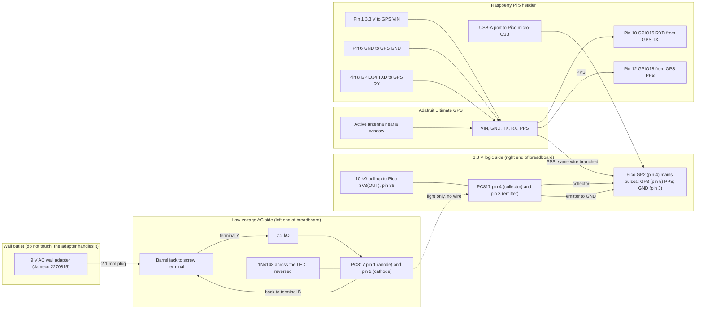

# Home grid-frequency logger (Raspberry Pi 5, Seal Beach CA, US West grid)

Written 2026-11-03. Prices and stock were read from the store pages on 2026-11-03 and will change.

## What this builds, in one paragraph

A small box next to your Raspberry Pi 5 that measures the frequency of the US Western grid once a second and writes it to a daily file, timestamped in UTC to within about a microsecond using a GPS receiver. Provenance can then race your own recordings against your own log, labelled "US West (home)". This fills the big gap in public US data: the free logs stop in November 2024 (Zenodo) and May 2026 (the FNET scrape).

The design follows Mark Pigott's jp3141/60Hz project (https://github.com/jp3141/60Hz), which logged Phoenix for a year with a Teensy 3.2, a GPS and a small AC transformer. The Teensy 3.2 is discontinued at PJRC, so this guide uses a Raspberry Pi Pico (RP2040) as the counter instead, and keeps the Teensy option for anyone who already owns one.

## Safety first (read this before buying anything)

- **Use only a plug-in low-voltage AC adapter** (a "wall wart" whose label says something like "OUTPUT 9V AC"). It has a sealed, UL-listed transformer inside. Everything you touch is on its low-voltage side.
- **Never open the adapter, never cut into a mains cord, and never connect anything to a wall outlet's wires.** Nothing in this project needs 120 V wiring.
- **It must say AC output, not DC.** A DC adapter has no 60 Hz wave left in it and will not work. A "9 V DC" phone-style charger is the wrong part.
- **The optocoupler keeps the 9 V AC side separate from the Pi and Pico.** Keep the two sides on opposite ends of the breadboard and never connect a wire from the 9 V side to the Pi or Pico.
- **9 V AC is low voltage but not nothing:** its peaks reach about 13 to 16 V. Unplug the adapter before changing any wiring.
- If anything gets hot, smells or buzzes, unplug the adapter first.

## Parts list (prices as of 2026-11-03)

You already have the Raspberry Pi 5 (and presumably its power supply, microSD card and case). Everything below is for the logger.

| # | Part | Why | Where (link checked 2026-11-03) | Price |
|---|---|---|---|---|
| 1 | Adafruit Ultimate GPS Breakout (PA1616S, 66 channel, PPS output) | UTC time and the exact start of each second (PPS) | https://www.adafruit.com/product/746 (in stock) | $29.95 |
| 2 | Active GPS antenna, 28 dB, 5 m cable, SMA | Lets the GPS see the sky from a window | https://www.adafruit.com/product/960 | $21.50 |
| 3 | SMA to uFL adapter cable | Connects the antenna to the breakout | https://www.adafruit.com/product/851 | $3.95 |
| 4 | Raspberry Pi Pico (RP2040), no headers | The cycle counter | https://www.adafruit.com/product/4864 | $4.00 |
| 5 | Male header strips, 0.1 inch, 10 pack | To solder onto the Pico (the pre-soldered Pico H, #5525, and black header #392 were out of stock) | https://www.adafruit.com/product/4154 (49 in stock) | $4.95 |
| 6 | USB A to Micro-B cable, 3 ft | Pico to Pi (power and data) | https://www.adafruit.com/product/592 | $2.95 |
| 7 | 9 V AC, 1 A AC-to-AC wall adapter, UL/CUL, 2.1 mm plug | The safe, isolated 60 Hz signal | https://www.jameco.com/z/GPU480901000WAOO-Jameco-Reliapro-9-VAC-1A-AC-to-AC-Wall-Adapter-Transformer-2-1mm-Plug-Level-VI_2270815.html (89 in stock) | $10.49 |
| 8 | 2.1 mm barrel jack to screw terminal adapter | Connects the adapter's plug to wires | https://www.adafruit.com/product/368 | $2.00 |
| 9 | PC817 optocoupler | Turns the AC wave into clean 3.3 V pulses, with isolation | https://protosupplies.com/product/pc817/ (62 in stock) | $0.25 |
| 10 | 1N4148 diode (sold in tens at $0.055 each) | Protects the optocoupler's LED from reverse voltage | https://www.jameco.com/z/1N4148-Fairchild-onsemi-Diode-1N4148-100V-200mA-10mA-If-Small-Signal-Switching-Bulk-_36038.html | $0.55 |
| 11 | 2.2 kΩ resistors, pack of 25 | Limits the optocoupler LED current to about 5 mA | https://www.adafruit.com/product/2782 (24 in stock) | $0.75 |
| 12 | 10 kΩ resistors, pack of 25 | Pull-up on the pulse output | https://www.adafruit.com/product/2784 | $0.75 |
| 13 | Half-size breadboard | Holds the circuit, no soldering for the front end | https://www.adafruit.com/product/64 | $4.95 |
| 14 | Female/male jumper wires, 20 x 6 inch | Pi header to breadboard | https://www.adafruit.com/product/1954 | $1.95 |
| | **Total for the logger** | | | **$88.99** |
| opt. | Official 27 W USB-C Pi 5 power supply, if you don't have one | Pi 5 power | https://www.adafruit.com/product/5814 | $14.04 |
| | **Total with the power supply** | | | **$103.03** |

Totals are before sales tax and shipping, from three stores (Adafruit, Jameco, ProtoSupplies). You need a soldering iron for two jobs: the GPS breakout's header (included with it) and the Pico's headers. [VERIFY] shipping costs and any Jameco minimum order or tariff surcharge (the Jameco page says the adapter "is subject to a tariff").

Teensy option (only if you already own one): a Teensy 3.2 or LC runs jp3141's original 60Hz.ino. Both are discontinued at PJRC, so don't plan a purchase around them.

## How it works

- The 9 V AC adapter gives a small copy of the grid's 60 Hz wave.
- The optocoupler's LED lights on every positive half-wave, and its transistor pulls the Pico's input low. That gives one clean pulse per grid cycle, with no electrical connection to the AC side.
- The Pico timestamps every pulse with its 125 MHz clock (in a PIO state machine, so no pulse is missed). Every GPS second it reports how many whole cycles happened and how many clock ticks they took. Frequency = cycles ÷ time.
- The GPS PPS pulse also calibrates the Pico's crystal, so its few parts-per-million error doesn't leak into the frequency. That matters: 1 ppm of crystal error is 0.06 mHz.
- The Pi reads the Pico's lines over USB, stamps each second in UTC from its own clock, and writes the daily CSV. The Pi's clock is locked to the same GPS PPS by chrony, so the time column is good to about a microsecond.

## Wiring



Wire list, in words:
1. Adapter plug into the barrel-jack terminal block. Call its two screw terminals A and B (AC has no polarity).
2. Terminal A to one end of the 2.2 kΩ resistor. The other end of the resistor to PC817 pin 1 (anode, the pin next to the dot).
3. PC817 pin 2 (cathode) back to terminal B.
4. The 1N4148 across pins 1 and 2, **reversed**: its striped end to pin 1, plain end to pin 2. It carries the negative half-waves so the LED never sees reverse voltage.
5. PC817 pin 3 (emitter) to Pico GND. PC817 pin 4 (collector) to Pico GP2, with the 10 kΩ from GP2 to Pico 3V3(OUT).
6. GPS VIN to Pi pin 1 (3.3 V), GPS GND to Pi pin 6. GPS TX to Pi pin 10 (GPIO15), GPS RX to Pi pin 8 (GPIO14).
7. GPS PPS to Pi pin 12 (GPIO18) **and** to Pico GP3 (pin 5). Pico GND to the Pi ground too (the USB cable already shares it, a second ground wire does no harm).
8. Pico micro-USB to a Pi USB port. Antenna to the GPS through the uFL adapter, antenna on a windowsill or outside.

[VERIFY] The PPS output of the Ultimate GPS is 3.3 V logic when powered from 3.3 V; check with a meter or the Adafruit pinout page before connecting it to the Pi and Pico, which are not 5 V tolerant.

## Setup steps

### 1. Pi 5 software (about 10 minutes)

On the Pi (Raspberry Pi OS Bookworm or newer), copy the `home_logger/` folder over (USB stick or `scp`), then:

```
cd home_logger
sudo ./install.sh --dry-run    # shows every change first
sudo ./install.sh
sudo reboot
```

What `install.sh` does:
- installs gpsd, chrony, pps-tools and python3-serial
- adds `enable_uart=1`, `dtparam=uart0=on` and `dtoverlay=pps-gpio,gpiopin=18` to `/boot/firmware/config.txt`, and turns the serial login console off
- sets gpsd to read `/dev/ttyAMA0` and `/dev/pps0`
- writes `/etc/chrony/conf.d/gps-pps.conf`: GPS sentences for the second number, PPS for the exact edge
- installs the scripts to `/opt/gridfreq`, the `gridfreq-logger@<you>` service and log rotation

[VERIFY] On the Pi 5 the header UART is `/dev/ttyAMA0` with `dtparam=uart0=on`. Older guides for the Pi 3 and 4 use `/dev/serial0` or `ttyS0`; if `gpsmon` shows nothing, check `ls -l /dev/serial*` and fix `/etc/default/gpsd`.

### 2. Pico firmware (about 5 minutes)

1. Download the MicroPython UF2 for "Raspberry Pi Pico" (RP2040) from https://micropython.org/download/RPI_PICO/.
2. Hold the Pico's BOOTSEL button while plugging it into the Pi. It appears as a USB drive; copy the UF2 onto it. It reboots into MicroPython.
3. Copy the firmware:
   ```
   python3 -m venv ~/mpr && ~/mpr/bin/pip install mpremote
   ~/mpr/bin/mpremote cp home_logger/pico/main.py :main.py
   ~/mpr/bin/mpremote reset
   ```
4. Check it: `~/mpr/bin/mpremote` should print one `F,...` line per second, for example `F,120,60,124998012,59.99871,1.734,OK`. The fields are: line number, whole cycles, clock ticks, frequency in Hz, crystal error in ppm, and a flag (OK, CAL in the first 16 s, NOPPS if the GPS pulse is missing, GLITCH if a noise pulse was merged). Press Ctrl-] to leave.

[VERIFY] The Pico firmware was written from the RP2040 datasheet and MicroPython documentation and has not been run on real hardware yet. Expect to check it on the bench first: with no AC connected it should print 0 cycles; with AC it should print 59 to 61 cycles and a frequency within about 0.05 Hz of 60.

### 3. GPS lock and clock discipline

- Wait 5 to 15 minutes with the antenna near a window for the first fix.
- `cgps` (from gpsd-clients) should show a 3D fix.
- `sudo ppstest /dev/pps0` should print one line a second.
- `chronyc sources -v` should show the PPS line with a `*` (selected). `chronyc tracking` should show "System time" offsets of a few microseconds.

### 4. Start logging (1 s, UTC)

```
sudo systemctl start gridfreq-logger@$USER
tail -f ~/gridfreq/gridfreq_$(date -u +%F).csv
```

The service starts on every boot, restarts itself if it stops, and logs its own status to `/var/log/gridfreq/logger.log`. Logrotate keeps 8 weeks of that status log, compressed. The data files are separate:
- one file per UTC day, `~/gridfreq/gridfreq_YYYY-MM-DD.csv`, about 4 MB a day
- files 2 or more days old are gzipped automatically (about 1 MB a day)

To use a Teensy running jp3141's code instead, edit the service's ExecStart to `--source teensy` (it reads `/dev/serial0` at 57600 baud and asks once per UTC second).

### 5. The CSV format (what Provenance reads)

```
time_utc,frequency_hz,cycles,flags,clock_sync
2026-11-03T18:00:00Z,59.998721,60,OK,pps
```

- `time_utc` is the start of the one-second interval, in UTC.
- `frequency_hz` is the frequency over that second.
- `flags` comes from the Pico (OK, CAL, NOPPS, GLITCH).
- `clock_sync` is `pps` when chrony is locked to the GPS pulse, `ntp` when only internet time is available, or `unsync`.

Provenance's ENF tab accepts this file directly as "My reference file", and its CSV reader knows the `time_utc` and `frequency_hz` headers. `home_logger/convert_csv.py` merges days or converts jp3141 logs (`--tz-hours` for logs in local time) into the same format.

## Self-test

After an hour or more of logging:

```
python3 /opt/gridfreq/selftest.py ~/gridfreq/gridfreq_$(date -u +%F).csv --fnet
```

It checks:
1. **Clock:** chrony locked to PPS, and the offset.
2. **Numbers:** the mean should be within about 20 mHz of 60 Hz. Over a day the spread is typically 10 to 25 mHz and second-to-second steps 1 to 3 mHz. (On two real 2024 WECC days the spread was 21.5 and 17.5 mHz, and the steps 2.1 and 3.05 mHz.) A dead input gives no rows, or exactly 60.000000.
3. **Minute pattern:** US West frequency dips slightly in the first few seconds of every clock minute (Hartmann et al. found this in the 2024 data; on the Zenodo test days the low point was at second 4). After a few hours, your log should show the same dip near the start of the minute. If the dip sits elsewhere, the timestamps are offset.
4. **Live comparison by eye (`--fnet`):** it saves the public FNET/GridEye frequency gauge page (University of Tennessee, fnetpublic.utk.edu) to `/tmp/fnet_gauge.html` and prints your latest reading. Open the page and compare its WECC value. They should agree within a few mHz. This only reads a public page, it does not sign in or send anything. Rob Ruark's public dashboard (robruark.com/projects/grid_frequency/AI/) is a second live check.

## Getting the logs into Provenance

Nothing is sent anywhere unless you set it up.
- **Same machine:** if Provenance runs on the Pi, import directly:
  ```
  python home_logger/import_to_provenance.py --from-dir ~/gridfreq
  ```
- **Another machine:** copy the logs with `DEST=you@laptop.local:gridfreq/ /opt/gridfreq/sync_to_box.sh` (rsync over SSH, only to a destination you set; a cron line is in the script), then run the importer there with `--from-dir` pointing at the copied folder.

`import_to_provenance.py` writes one file per UTC day to `~/.cache/provenance/enf/us/home/`. It uses only seconds whose clock was locked to GPS PPS, unless you pass `--allow-ntp`. After that:
- Provenance's US West race includes "US West (home)".
- The coverage panel shows the dates it covers.

## Files

| File | What |
|---|---|
| `home_logger/install.sh` | Pi setup: packages, UART and PPS overlay, gpsd, chrony, service, log rotation (`--dry-run` to preview) |
| `home_logger/pico/main.py` | Pico counter firmware (MicroPython, PIO edge timestamps, PPS calibration) |
| `home_logger/grid_logger.py` | The logger service: reads the Pico (or a Teensy), writes daily UTC CSVs |
| `home_logger/gridfreq-logger@.service`, `gridfreq.logrotate` | systemd unit and log rotation |
| `home_logger/convert_csv.py` | Converts and merges logs (also jp3141 format) |
| `home_logger/selftest.py` | Clock, statistics, minute-pattern and live FNET checks |
| `home_logger/import_to_provenance.py` | Imports logs as "US West (home)" |
| `home_logger/sync_to_box.sh` | Optional rsync to a machine you choose |

## [VERIFY] list

- Pico firmware has not been run on hardware.
- Pi 5 UART device name and the pps-gpio overlay on your OS release.
- The GPS PPS voltage level (should be 3.3 V).
- Adafruit #746 stock and the module revision on arrival (Adafruit lists the PA1616S; the original module was discontinued in 2021).
- Shipping, tax and the Jameco tariff note.
- Teensy 3.2 and LC availability (discontinued at PJRC).
